# Hi, I'm Yixin Chen 👋

[中文](README.md) | [English](README_EN.md) | [下载作品集 PDF](yixin-chen-portfolio.pdf)

我是陈奕昕，目前在南方医科大学读应用统计硕士，本科是生物统计学。

平时主要接触临床研究、统计建模和数据分析，也喜欢折腾一些自己感兴趣的项目，比如用 R Shiny 开发样本量计算工具、探索真实医疗数据，以及 AI 在统计研究中的应用。在 Parexel 和 Frost & Sullivan 的两段实习，也让我有机会从不同角度了解医疗研究和行业实践。

简历只有一两页，很多项目的过程、实际成果和照片都放不下。所以把它们整理在这里，除了科研和实习，还有我写过的文章、参加的比赛，以及运动和旅行的记录。

**Biostatistics · Clinical Research · RWD/RWE · Data & AI**

## 📑 目录

- [01 About Me｜关于我](#01-about-me) — 教育背景与专业基础
- [02 Projects & Research｜科研与项目](#02-projects--research) — 统计工具、临床研究与数据分析
- [03 Professional Experience｜实习经历](#03-professional-experience) — Parexel · Frost & Sullivan
- [04 Achievements & Credentials｜荣誉与证书](#04-achievements--credentials) — 专业资格、学术竞赛与体育荣誉
- [05 Writing & Sharing｜写作与分享](#05-writing--sharing) — 嗨森的糖罐子 · 公众号运营与精选文章
- [06 Beyond Statistics｜统计之外](#06-beyond-statistics) — 旅行、摄影与国际研学
- [Contact｜联系方式](#联系方式)

## 01 About Me

### 学术成绩证明 

**官方成绩单 (2022-2025)**

- 总平均绩点：3.53/5.0 

- 专业排名：12/39

- 核心专业课程：循证医学（97）、数据管理（98）、生存分析（96.5）、临床试验设计（95.7）、R语言（95）、统计建模（94.9）等成绩优异

  查看成绩单:  [南方医科大学成绩单.pdf](evidence/academic/smu-undergraduate-transcript.pdf) 

## 02 Projects & Research

### 临床试验样本量计算器（SampleSize_R）– 本科毕业设计

**项目描述**：作为应用统计学专业本科的毕业设计，独立开发了一个基于 R Shiny 的临床试验样本量计算工具，系统实现了 **32 种主流临床研究设计**的样本量计算方法，涵盖均数比较、率比较、等效性检验、生存分析、相关系数、回归分析及分类变量分析等。工具提供了三维筛选（数据类型、检验类型、设计类型）、动态参数面板、脱落率调整、功效曲线可视化等功能，并配备了详细的用户手册和扩展指南。

**关键技术**：R-Shiny、`PowerTOST`、`gsDesign`、`npsurvSS`、动态 UI 生成、统计建模、参数转换。

**项目成果**：完成了一个功能完整、文档齐全、易于扩展的专业级样本量计算工具。通过毕业设计，系统梳理了临床试验设计中的统计原理，并实践了从需求分析、架构设计到编码实现的全流程开发。项目代码结构清晰（模块化函数、参数模板、示例内容），便于后续研究者添加新方法。

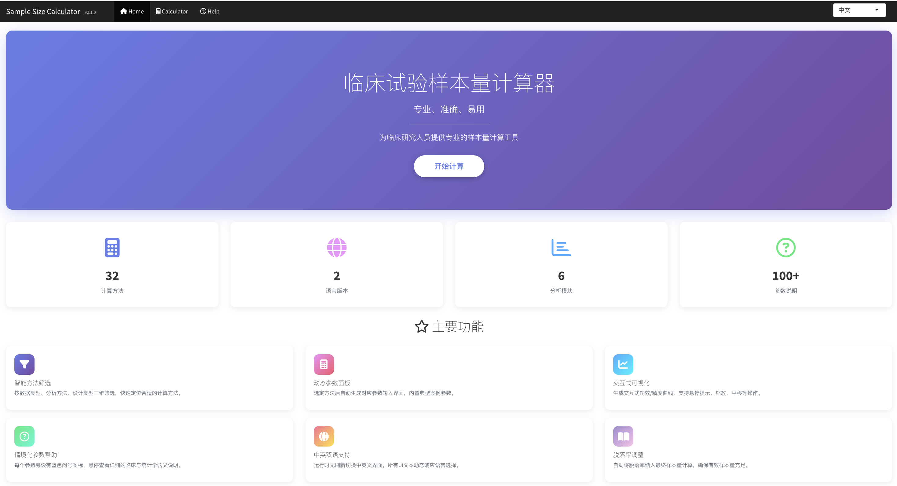

**项目链接**：[在线演示](https://cathy-chenyx.shinyapps.io/SampleSize_R/) | GitHub 仓库（代码暂未公开）

**项目亮点**：

- **方法全面**：除基础统计分析方法外，包含生存分析（Logrank、RMST、里程碑生存率）、相关系数检验、多元线性回归偏 F 检验、有序分类变量比例优势模型等复杂设计。
- **严谨可扩展**：基于 `calculators_db.xlsx` 注册表管理计算方法，新增方法只需按模板添加，无需修改核心代码。
- **学术产出**：毕业设计文档包含详细的统计理论笔记、用户手册和开题报告，可作为后续研究的参考。

------

### 样本量计算智能助手（SSEA）– 参与开发

**项目描述：** 作为具有统计背景的学生，参与了一个珠江医院课题组临床研究计算平台（SSEA）的研发。主要负责统计方法的参数设计、验证以及部分用户文档的撰写。平台覆盖 RCT、观察性研究、诊断试验等研究场景，旨在降低临床研究者使用样本量计算的门槛。

**贡献内容**：

- 协助验证样本量计算结果的准确性（误差率 < 0.1%）
- 参与撰写 [SSEA 使用指南系列推文](https://mp.weixin.qq.com/s/t2dFiUKlmI-tuyuoxMN4wA)，帮助用户理解参数设置
- 提供统计咨询，确保方法选择的合理性

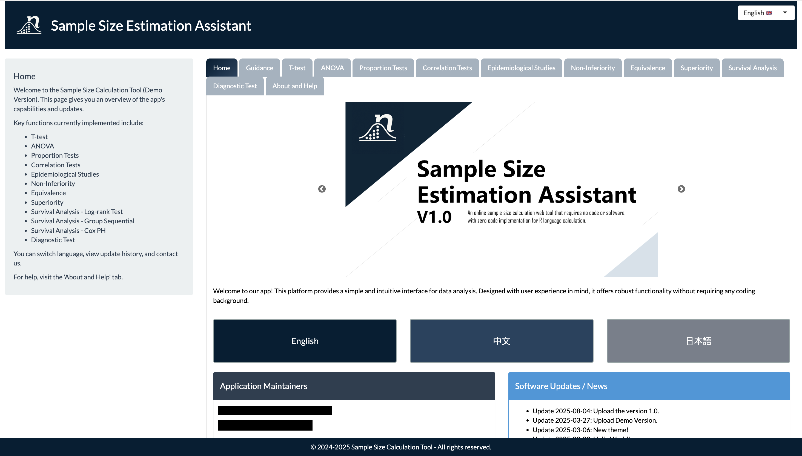

**项目链接:** [SSEA 在线平台](https://smuonco.shinyapps.io/SSEA/)

**使用教程系列推文：**

- [SSEA 使用指南（一）：研究场景选择与参数设置](https://mp.weixin.qq.com/s/t2dFiUKlmI-tuyuoxMN4wA)
- [SSEA 使用指南（二）：诊断试验样本量计算详解](https://mp.weixin.qq.com/s/CwgVe3YOLTO4wzeEAUZWZA)
- [SSEA 使用指南（三）：观察性研究样本量计算实战](https://mp.weixin.qq.com/s/DM30R7HMBcpnrCx6Ny1T8Q)
- [SSEA 使用指南（四）：RCT研究中的样本量估算](https://mp.weixin.qq.com/s/xMvXZt7on93Tatr4KivF4A)

**扫码体验：**

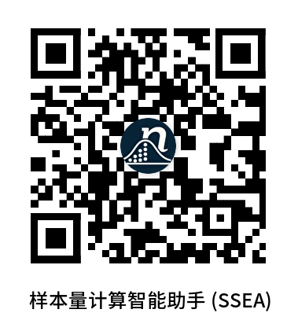

### STEMI 患者院内消化道出血预测模型 – 统计建模大赛参赛作品

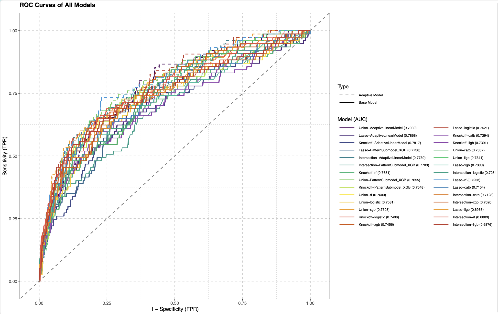

**项目描述**：基于广东省人民医院 2010‑2020 年 STEMI 患者真实世界数据，开发可解释的消化道出血风险预测模型，辅助临床早期识别高危患者、优化抗栓与胃黏膜保护策略。

**关键技术**：R、Python、多重插补 (mice)、Knockoff + Lasso 双重变量选择（FDR 控制）、自适应线性回归、模式子模型、集成学习 (Stacking/Boosting)、SHAP 可解释性、决策曲线分析 (DCA)

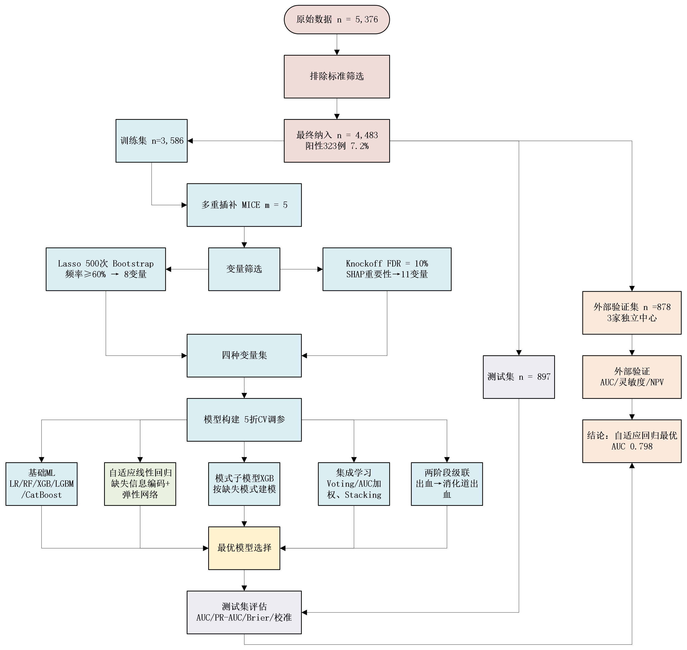

**项目成果**：

- 构建完整分析 Pipeline（数据清洗 → 80%以上高缺失变量剔除 → 多重插补 → 变量筛选 → 模型训练与验证）。
- 系统比较 4 种变量集（Knockoff/Lasso/Union/Intersection）与 12 种模型（随机森林、XGBoost、LightGBM、CatBoost、逻辑回归、自适应线性回归等）。
- **最优模型 (Knockoff + 自适应线性回归) 测试集 AUC 达到 0.7977**，显著优于 CRUSADE (0.659)、HAS‑BLED (0.612)、HEMORRHAGES (0.688) 等传统出血评分。
- 创新处理真实世界缺失数据：引入自适应线性回归与模式子模型，无需预先插补即可利用缺失模式进行预测，避免插补误差。
- 输出临床可解释的 11 个关键预测因子（入院 48h 内 PPI 使用、血肌酐、血红蛋白、直接胆红素、尿酸等），并通过 SHAP 分析和决策曲线证实模型在较宽阈值范围内具有正向净获益。

**相关链接**：

- [GitHub 项目仓库](https://github.com/Cathy-chenyx/STEMI_Predictive_model)

### LLM 在科学同行评审中的使用趋势与模型有效性研究

**项目时间：** 2026.06–至今｜合作科研项目 | 统计建模、模型实现与验证分析

**项目描述：** 随着大语言模型逐渐进入学术写作，一个值得研究的问题是：ChatGPT 发布前后，科学同行评审文本的语言分布是否发生了变化？

本研究借鉴已有的群体语言混合估计方法，将最大似然估计（MLE）框架应用于公开同行评审语料，通过构建人类写作（H）与 LLM-like 语言（Q）参考分布，估计不同期刊、不同时期审稿文本的语言混合参数 α，并进一步考察模型对不同 AI 编辑方式的响应。

*研究正在进行中，相关结果与分析材料暂未公开。*

### ACS 患者应激指标预后价值研究 – 多队列数据分析与风险预测

**项目描述**：基于广东省人民医院 2010–2015 年 >4,000 例 ACS 住院患者真实世界数据，系统评估 7 个入院应激指标（HsCRP、BUN、CystatinC、NT-proBNP、Uric acid、WBC、Lactate）对短期及长期临床结局（全因死亡、MACE）的独立预测价值，为临床风险分层提供循证依据。

**关键技术**：R、生存分析（KM + Cox 回归）、多因素 Logistic 回归、ROC 分析、糖尿病三水平分层编码、缺失模式分析

**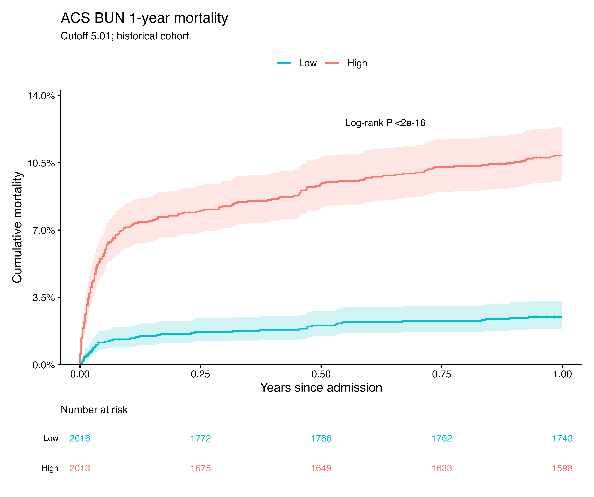**

**项目成果**：

- 完成 ACS 全体、STEMI、UA+NSTEMI 三队列的完整分析流程（数据清洗 → 基线比较 → 单因素 → 多因素 → 综合模型 → ROC 分析）
- 乳酸对 STEMI 长期死亡的 Cox 回归 HR = 1.21（95% CI 1.11–1.31），高乳酸组 KM 曲线在 30 天/1 年/3 年均显著高于低乳酸组
- HsCRP、BUN、CystatinC、NT-proBNP 在多因素模型中对 Death/MACE 呈现独立预测价值；多个应激指标 AUC > 0.6
- 建立规范的 R 脚本流程与函数库（14 个脚本），保证分析可复现性

**项目链接**：GitHub 仓库（代码暂未公开）

### 亚太地区消化道癌症负担 GBD 数据分析

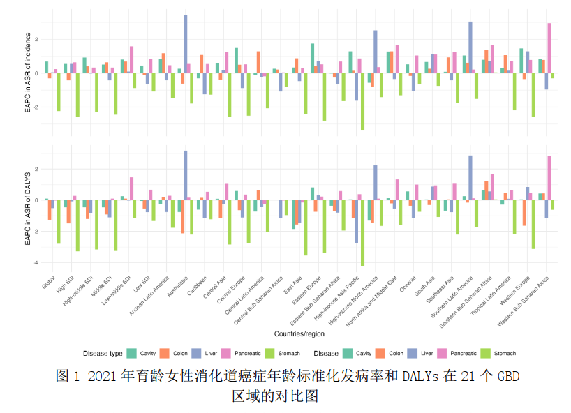

**项目描述：** 基于全球疾病负担（GBD）数据，分析亚太地区消化道癌症的流行病学趋势与地区差异。

**关键技术：** Joinpoint 回归、APC 分析、ICD-10 编码标准化、数据可视化

**项目成果：** 识别关键趋势拐点（APC = -0.8%, p<0.05），构建 15+ 可视化图表支持决策

**相关产出：** 《[统计建模-GBD疾病负担分析.pdf](reports/gbd-gastrointestinal-cancer-burden.pdf) 》

### 游戏用户留存预测 – XGBoost 机器学习应用

**项目描述：** 构建并部署用户流失预测系统，解决数据不平衡问题并实现高精度实时预测。

**关键技术：** XGBoost、SMOTE、SHAP 可解释性分析、R-Shiny 部署

**项目成果：** 准确率 91.18%，获 SAS 高校数据分析大赛全国二等奖

**相关产出：** 《[游戏用户留存度预测分析.pdf](reports/game-user-retention-prediction.pdf) 》

**项目链接：** https://gameretainpredictlab.shinyapps.io/smu-XGboost/

**扫码体验：**

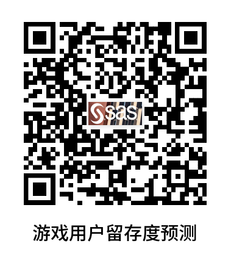

### 其他学术产出（专业课程报告）

- 《[生存分析-左截断数据基于面积法的假设检验方法](reports/left-truncated-survival-area-test.pdf) 》

- 《 [时间序列分析-循环神经网络模型的应用比较研究](reports/recurrent-neural-network-comparison.pdf) 》

- 《[统计模拟-两阶段交叉设计率比较检验方法的模拟研究](reports/two-stage-crossover-proportion-tests.pdf) 》

- 《 [遗传统计学_遗传变异的因果结构学习——基于双向介导MR（BIMMER)与结合图论和MVMR的因果网络修剪方法（MRSL）](reports/genetic-causal-structure-learning.pdf)》

  等共 9 篇专业文档（详见[课程与项目报告](reports/)）

## 03 Professional Experience

### 精鼎医药研究开发（上海）有限公司（Parexel International）

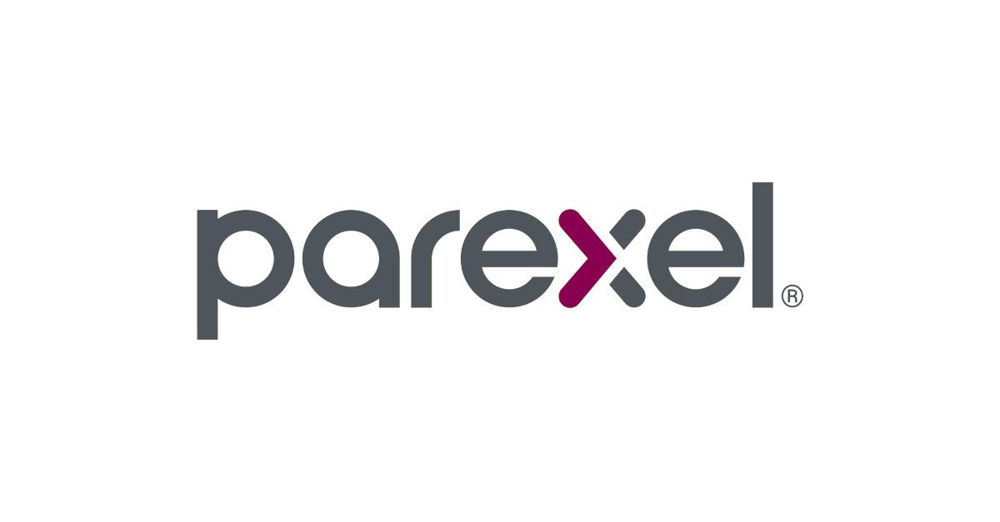

**RWD Strategy Intern**  | APAC RWD Strategy

真实世界数据战略实习生	*2026年3月 – 2026年9月 | 广州*

精鼎医药是全球领先的合同研究组织（CRO），总部位于美国，业务覆盖全球。其亚太区 RWD（真实世界数据）战略团队专注于为药企客户提供基于真实世界数据的可行性评估、数据源管理及真实世界证据（RWE）研究支持，覆盖中国大陆、香港、台湾、日本、韩国、新加坡、印度、中东等新兴市场。

作为全球顶尖CRO公司（合同研究组织）亚太区RWD战略团队实习生，在这半年里，我参与了多个亚太地区医疗数据源相关项目。从文献检索、数据库资料整理，到数据源可行性比较、英文研究材料准备，以及不同团队之间的信息沟通，逐渐理解了真实世界研究开展之前需要做的那些准备工作。

-  [Parexel实习证明.pdf](evidence/internships/parexel-internship-certificate.pdf) 

### 弗若斯特沙利文（Frost & Sullivan）

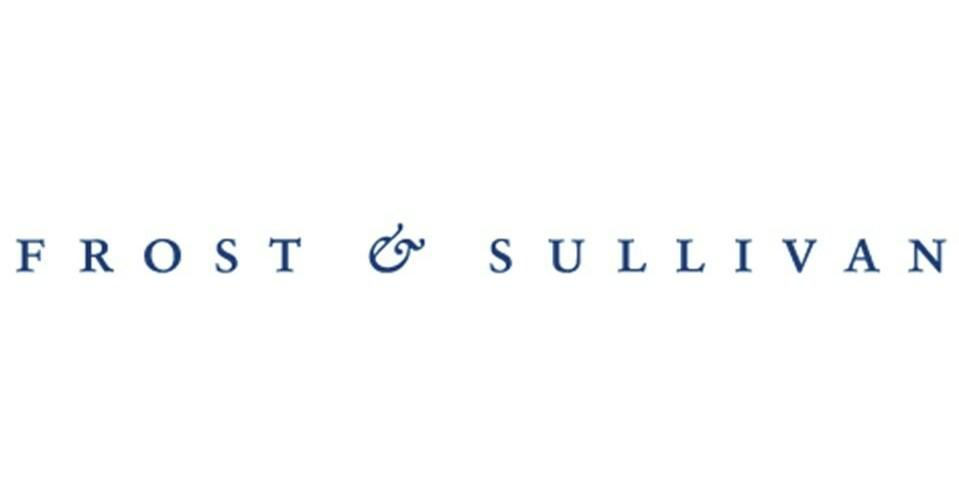

**Healthcare Consulting Intern** | Healthcare & Life Sciences

医疗健康咨询实习生	*2026年9月 – 至今 | Remote*

弗若斯特沙利文（Frost & Sullivan，简称“沙利文”）是一家全球性增长咨询公司，成立于1961年，并于1998年进入中国市场。其业务涵盖行业研究、战略咨询、市场分析、估值及资本市场咨询等领域。医疗健康业务涉及医药、生物科技、医疗器械及医疗服务等多个细分行业，为企业提供行业研究、市场与竞争格局分析及战略决策支持。

在沙利文医疗健康咨询团队实习期间，我参与了肿瘤与自身免疫疾病相关的行业研究、医药行业蓝皮书制作及研究资料交付。从研究问题拆解、文献检索和跨来源证据核对，到报告正文撰写、图表呈现与修改完善，逐步学习如何将复杂的临床、科研和行业信息整理为清晰、可追溯的研究成果。

*  [笔试通过及入职沟通邮件](evidence/internships/frost-sullivan-assessment-feedback.pdf) 

## 04 Achievements & Credentials

### 核心能力证书

| 证书名称                 | 颁发机构                                                     | 获得时间 | 级别/成绩 | 证明材料方式                                                 |
| :----------------------- | :----------------------------------------------------------- | :------- | :-------- | :----------------------------------------------------------- |
| 初级数据分析师           | 北京东方艾学信息技术有限责任公司                             | 2026.07  | 初级      | [初级数据分析师证书队长.pdf](evidence/academic/junior-data-analyst-certificate.pdf) |
| 统计专业技术资格（初级） | 人力资源和社会保障部、国家统计局                             | 2025.10  | 通过      | [初级统计师证书](evidence/academic/junior-statistician-certificate.pdf) |
| SAS Base 程序员认证      | SAS Institute                                                | 2025.05  | 通过      | [SAS Base 程序员认证](evidence/academic/sas-base-programmer-certificate.pdf) |
| 大学英语六级 (CET-6)     | 教育部                                                       | 2025.06  | 546分     | [CET6 - 546.pdf](evidence/academic/cet6-score-546.pdf) |
| 雅思IELTS                | British Council; IDP IELTS; Cambridge University Press & Assessment | 2025.02  | 6.0       | [IELTS.pdf](evidence/academic/ielts-score-report.pdf)                |
| 全国计算机二级           | 教育部                                                       | 2023.03  | 通过      | [计算机二级证书.pdf](evidence/academic/computer-level-2-certificate.pdf) |

### 学术竞赛荣誉

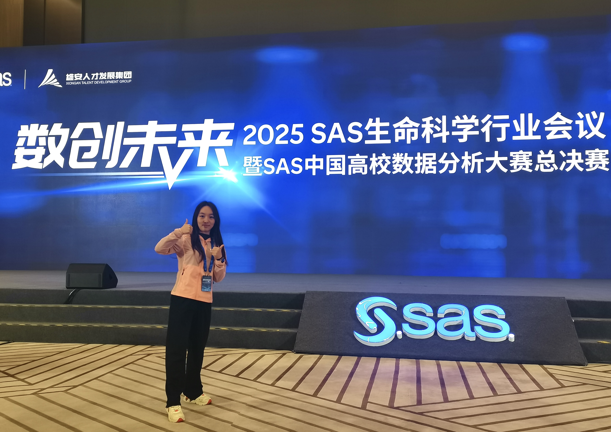

- 2024年 SAS 中国高校数据分析大赛 - 全国二等奖

  证明材料:  [SAS大赛获奖证书.pdf](evidence/awards/sas-data-analysis-second-prize.pdf) 
  [官方新闻链接](https://mp.weixin.qq.com/s/20FoBxp0UPmD3oKTmZS1yw)

- 2024年 全国大学生数学建模竞赛 - 广东省三等奖

  证明材料:  [数学建模国赛.pdf](evidence/awards/cumcm-guangdong-third-prize.pdf) 

- 2024年 美国大学生数学建模竞赛 - S奖

  证明材料: [数学建模美赛.pdf](evidence/awards/mcm-successful-participant.pdf) 

- 2025年全国大学生统计建模竞赛-广东省三等奖

-  证明材料: [第十二届统计建模大赛省赛证书.pdf](evidence/awards/statistical-modeling-provincial-third-prize.pdf) 

### 职业技能与综合发展荣誉

#### **第三届全国大学生职业规划大赛校赛特等奖（第一名）-省赛铜奖** (2025.11) 

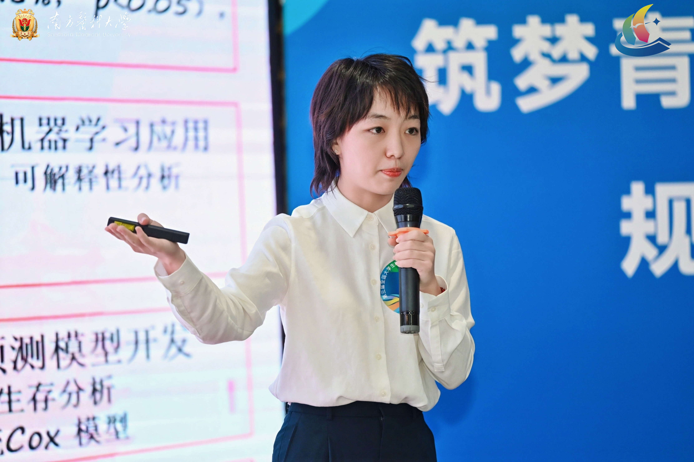

- 于全校超过2000名参赛者中脱颖而出，斩获就业赛道最高荣誉

[职业规划大赛-省赛铜奖奖状](evidence/awards/career-planning-provincial-bronze.pdf)

> 作为国家级职业规划大赛的校级选拔，该赛事旨在全面提升大学生就业竞争力。在决赛中，通过**主题陈述**与**综合面试**，系统呈现了个人能力矩阵与行业岗位的深度契合，展现了清晰的职业发展路径和扎实的求职实战能力。评审团由高校职业规划专家及知名企业人力资源负责人共同组成，奖项含金量高。
>
> **官方新闻链接:** [2000人竞逐，精英对决刮起职业规划旋风](https://news.smu.edu.cn/info/1014/125316.htm)

#### **第三届公共卫生领导力大赛｜团队二等奖**（2026.10）

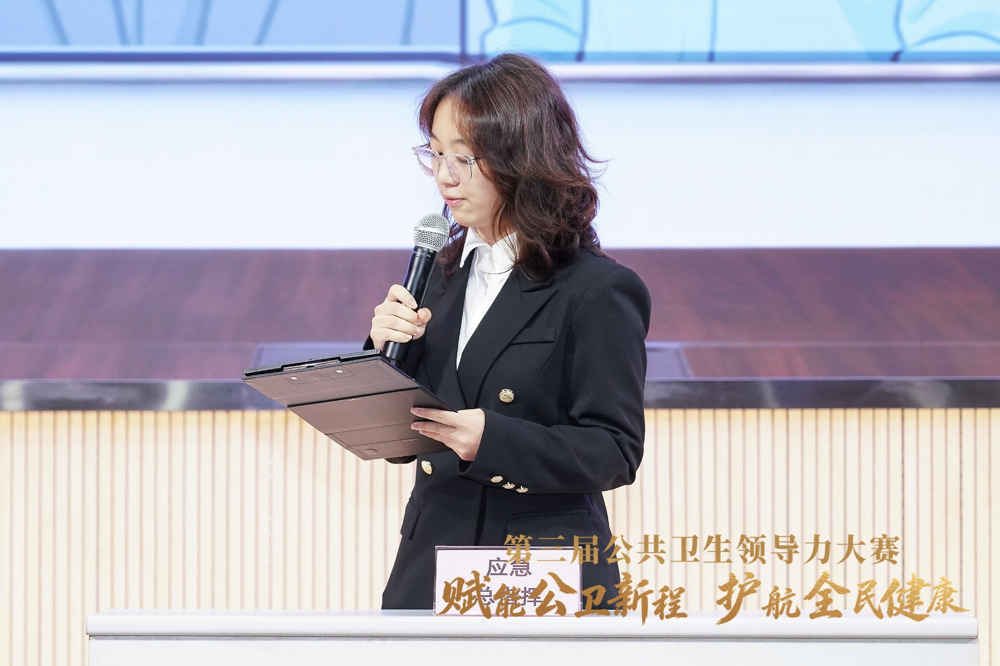

2026年10月，作为南方医科大学代表队成员参加第三届公共卫生领导力大赛，与粤港澳地区多所高校的公共卫生专业学生同台交流，最终获得**团队二等奖**。

比赛包括公共卫生知识竞答、案例展示及突发公共卫生事件模拟决策等环节，重点考察参赛团队的专业知识、应急分析与协作能力。

我主要负责团队方案中**大数据与AI防控方案及技术支持**相关内容，参与将公共卫生防控需求与数据分析、人工智能技术相结合的方案设计。

官方新闻链接：[赋能公卫新程，护航全民健康 —— 第三届公共卫生领导力大赛决赛圆满落幕](https://mp.weixin.qq.com/s/jAoXCa3XLTYxmzM88B6Mtw)

### 校内荣誉 

- **校一等奖学金** (2023-2024) 

- **校三等奖学金**（2024-2025）

- **校优秀学生** (2023-2024) （2024-2025）

- **公共卫生学院“十佳之星” - 体育之星** (2025) 
  - 授予在体育竞技领域取得突出成就、展现卓越体育精神与团队领导力的学生代表
  **官方新闻链接:** [2025年度第十五届公共卫生学院“十佳之星”风采展示](https://news.smu.edu.cn/info/1014/127546.htm)
  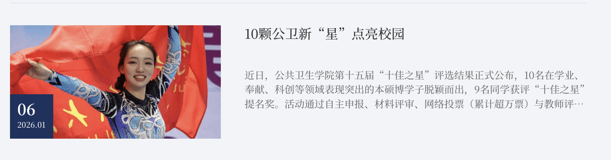

  **证明材料:**   [校内荣誉.pdf](evidence/awards/university-honors.pdf) 

### 体育竞技成就

​	累计荣获**国家级赛事银牌1项**、**铜牌1项**，**省级赛事金牌1项**、**银牌2项**，共计6项省级及以上高含金量奖项。

​	作为团队核心主力，在**中国大学生健美操锦标赛**及**广东省大学生健美操锦标赛**中，于**三人操、混合双人操、五人操**等多个集体项目中取得顶尖名次，展现了卓越的协同作战能力。

官方新闻链接🔗

- [五金二银一铜，连续三年团体总分第一！我校健美操队在省锦标赛掀起“南医旋风”](https://www.smu.edu.cn/info/1139/35559.htm)
- [校健美操队在中国大学生健美操锦标赛上获4枚铜牌](https://www.smu.edu.cn/info/1139/60389.htm)
- [健美操队闪耀省大运会赛场 技术突破与艺术表现双“银”](https://news.smu.edu.cn/info/1014/115606.htm)

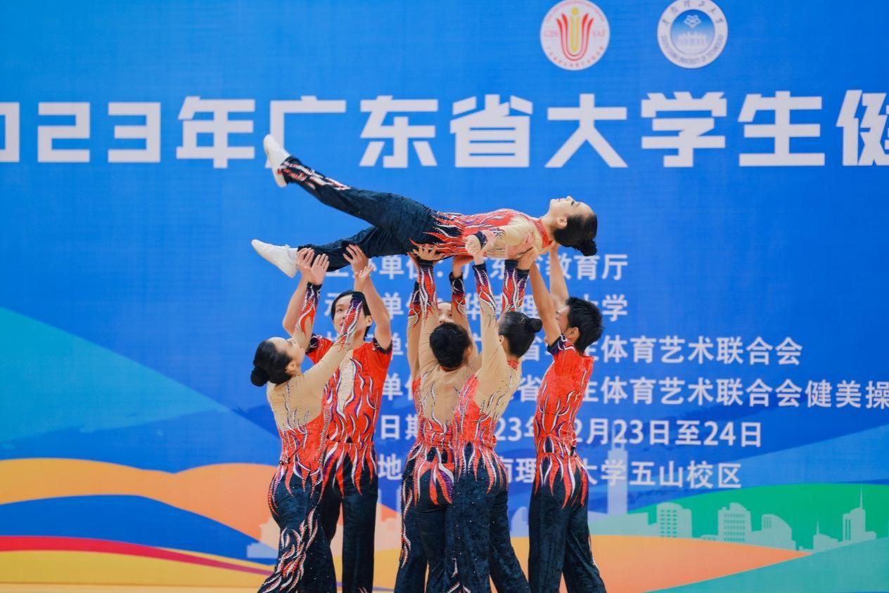

* **中国大学生健美操锦标赛 - 全国亚军** (2023)

> **证明材料:**  [国赛亚军.pdf](evidence/awards/national-aerobics-runner-up-2023.pdf) 

- **广东省大学生健美操锦标赛 - 团体总分第一名 & 徒手操冠军** (2024 & 2023)

> 作为团队绝对主力，两年内率队蝉联省级锦标赛**团体最高荣誉**，并个人主导项目斩获**省级冠军**，证明了持续的统治级表现与领导力。
>
> **证明材料:** [徒手操冠军.pdf](evidence/awards/guangdong-aerobics-freehand-champion-2023.pdf)  [团体总分.pdf](evidence/awards/guangdong-aerobics-team-first-2024.pdf) 

- **中国大学生健美操锦标赛 - 有氧踏板 第三名** (2024)

 > 在同一顶级赛事中，于不同项目上再次夺得国家级奖牌，体现了全面的技术适应性与稳定的高水平发挥。
 >
 > **证明材料:**  [有氧踏板第三名.pdf](evidence/awards/national-aerobics-step-third-18th.pdf) 

- **多项国家级、省级赛事集体项目四强** (三人操、混合双人操、五人操)

 > 在多个强调高度协同的集体项目中，作为核心成员均取得全国及省级前四强的优异成绩，是团队协作与信任精神的最佳证明。
 >
 > **证明材料：** [2023年省赛三人操_第四名.pdf](evidence/awards/guangdong-aerobics-trios-fourth-2023.pdf)  
 > [2024国赛五人操_第四名.pdf](evidence/awards/national-aerobics-group-five-fourth-18th.pdf)  
 > [2024国赛混合双人操_第四名.pdf](evidence/awards/national-aerobics-mixed-pairs-fourth-18th.pdf)  
 > [2024年省赛有氧踏板_第五名.pdf](evidence/awards/guangdong-aerobics-step-fifth-2024.pdf)  
 > [广东省大运会三人操_第四名.pdf](evidence/awards/guangdong-university-games-trios-fourth-12th.pdf) 

### 其他校园活动与奖项 

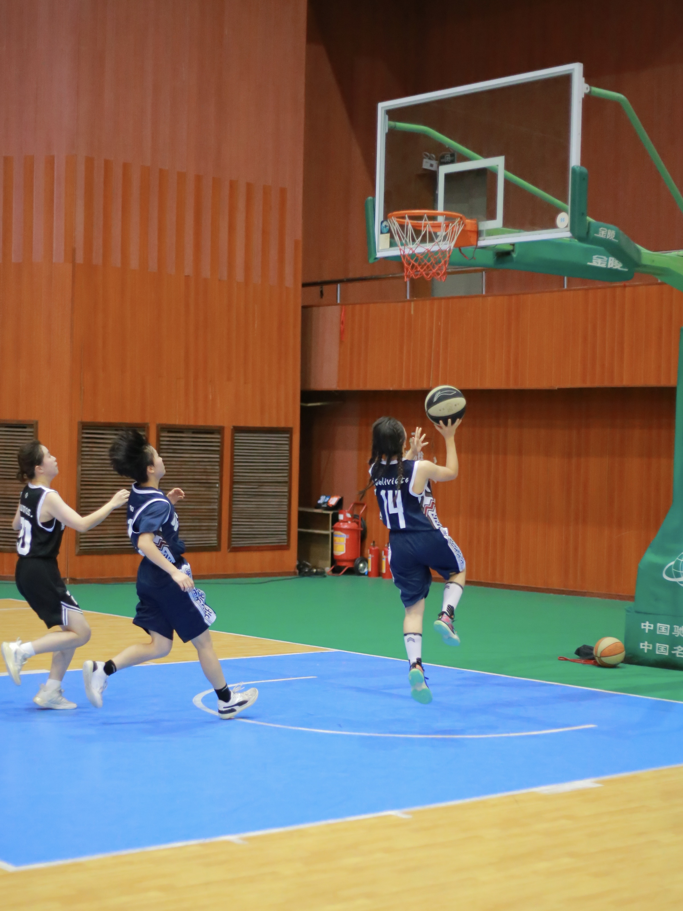

- 南方医科大学大满贯篮球赛冠军（2024）

- 南方医科大学凤翔杯篮球赛亚军 (2023)

- 南方医科大学凤翔杯乒乓球比赛第四名（2023）

- 南方医科大学校运会跳远第五名（2023）

- 南方医科大学跳绳比赛第五名（2024）

**证明材料:详见[补充证明材料](evidence/supplementary/)**

## 05 Writing & Sharing

公众号、专业文章、学术会议、学习分享

### 嗨森的糖罐子｜个人公众号

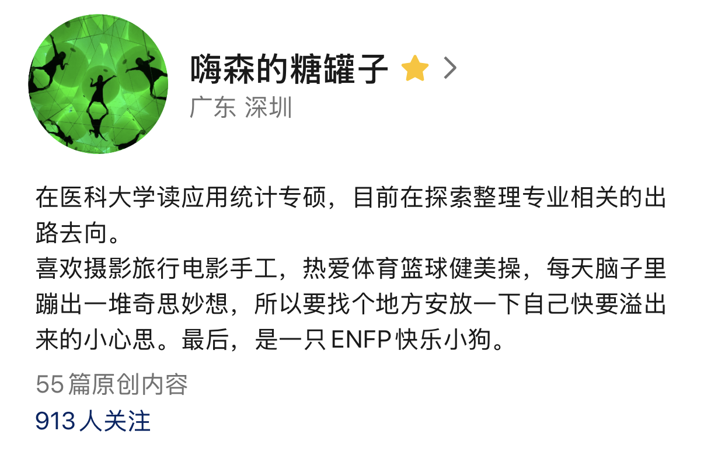

从本科开始，我就喜欢把学过的知识、做过的项目，以及生活中遇到的有意思的事情整理成文章，慢慢有了自己的公众号「嗨森的糖罐子」。

内容最初以专业课笔记、考研经验和学习资料为主，后来逐渐拓展到生物统计、真实世界研究、MIMIC 数据库、学术会议记录，以及旅行、影评和生活随笔。

#### 📊 运营概览

**内容创作**

- **内容创作：** 自2023年12月起持续运营，累计发布内容**50+次**，涵盖专业知识分享、学习经验、实用教程与个人随笔。
- **关注增长：** 2026年8月23日突破500关注；截至2026年11月下旬，累计关注人数接近900，近三个月保持增长。
- **传播表现：** 达成累计被用户分享1,000次、收藏500次的运营里程碑；代表性专业文章单篇阅读量超过5,000次。
- **读者互动：** 累计收到用户留言100次以上，持续通过评论与读者交流，并根据实际问题补充和改进内容。
- **内容运营：** 独立完成选题、资料整理、文章撰写、封面设计、图文排版及发布，并结合后台阅读、分享、收藏和读者反馈调整后续选题。

**代表性传播成果**

- 专业内容｜把学术会议中的发现分享给更多人
  《[2026生物统计年会｜医保数据做真实世界研究，能挖出什么？](https://mp.weixin.qq.com/s/J8dgx15jJm-n9E8T1muj4A)》
  阅读量 **5,718次**，累计收藏达到174次。围绕方积乾教授的特邀报告，梳理医保数据在真实世界研究中的潜力与局限，也记录了自己参加学术会议的见闻。

  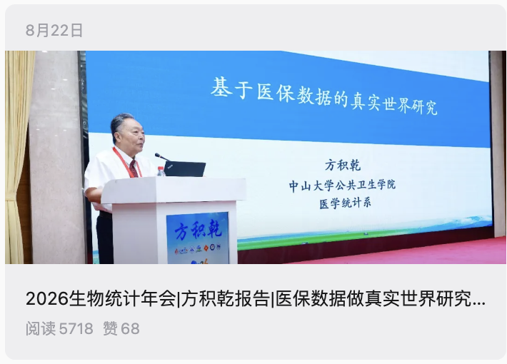

- 学习经验｜记录一段不那么完美的考研经历
  《[26应统考研｜我的考研这一年](https://mp.weixin.qq.com/s/9lZ0wqs8x-s5WFzpiLd-tg)》
  阅读量 **5,508次**，曾被学院公众号「公卫X生涯」转载。

  这篇文章并不是一份标准的高分经验贴。我记录了考研期间数学学不明白时的挫败、向师兄师姐寻求帮助的经历，也整理了英语、专业课的复习方法。

  当时写下这些，一方面是想给自己留个纪念，也希望后来准备考研的同学能够少走一点弯路。

  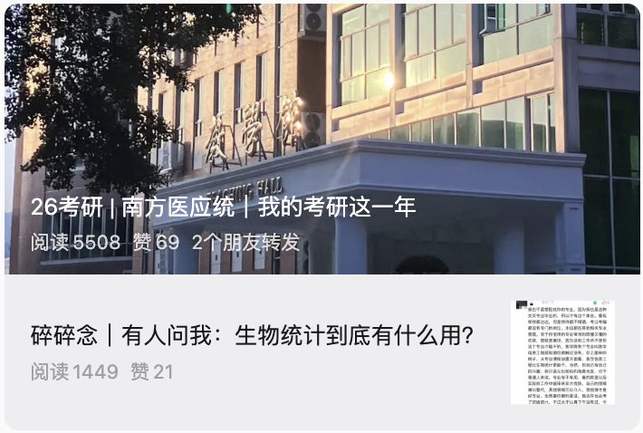

* **实用教程｜解决身边同学的实际问题**

《[从 i.smu 到 smu.edu｜南医研究生邮箱申请 + Outlook 配置指南](https://mp.weixin.qq.com/s/-1Cq8WnWDBZcddgREAeRHw)》

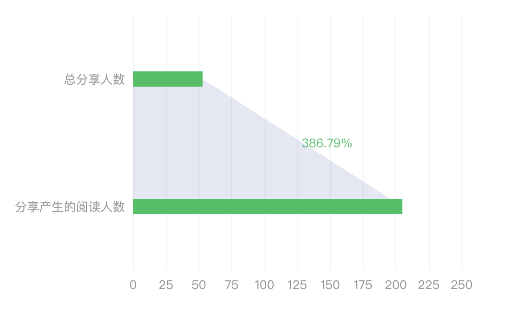

阅读 **3,388次**，获得 **353次分享、49次点赞、30次在看、22条留言**。

从自己申请和配置研究生邮箱的经历出发，整理了一份可以跟着操作的教程。它也让我发现，解决一个具体的小问题，有时比写一篇很长的文章更容易帮助到别人。

#### ✍️ 精选原创文章

**Career & Personal Stories｜经历与思考**

- [我不是想清楚了才出发的｜从考研、找工作到一段意外的 RWD 实习](https://mp.weixin.qq.com/s/AgghBncOssy6EyHbzN6aZQ)
  关于职业选择、求职经历，以及一次意外的实习机会。

**Biostatistics & Learning｜专业与学习**

- [碎碎念｜生物统计学｜我们专业到底是什么](https://mp.weixin.qq.com/s/pMTSRRFz8OGGw_DR4yJofQ)
  聊聊自己所学的生物统计，以及这个专业究竟在做些什么。
- [碎碎念｜统计专业技术资格考试｜种草or避雷？！](https://mp.weixin.qq.com/s/GGdP_tu5MNSAHMM2aHMhLQ)
  记录统计专业技术资格考试的准备经历和个人感受。

**Life & Stories｜生活与随笔**

- [《爱在黎明破晓前》｜有些人见一面，足够用一生去怀念](https://mp.weixin.qq.com/s/tN1r07jMXsnW2ksW_P9trg)
  一篇关于电影、相遇和记忆的随笔。

## 06 Beyond Statistics

### Travel & Photography｜旅行与摄影

除了统计，我还很喜欢旅行、拍照和写游记。

出发前通常会认真做攻略，查交通、安排路线、找想去的地方。但真正到了路上，总会遇到一些计划之外的人和事。很多时候，这些意外反而成为了旅行里最难忘的部分。

我习惯把旅途中的照片、行程和见闻整理成游记，既是给自己留一份记录，也希望能够给准备前往同一个地方的人提供一点参考。

**旅行主页**：[马蜂窝｜旅行笔记](https://www.mafengwo.cn/u/58350948/note.html)

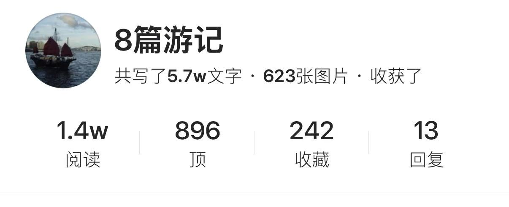

#### 精选游记

* [环岛自驾，奔赴山海与人间烟火——海南深度旅行笔记](https://www.mafengwo.cn/i/24805402.html)
  *2026年1月 · 海南*

  

**平台认证**：⭐ **马蜂窝“星级游记”**

**核心亮点**：独立策划并执行长达6天、超600公里的海南环岛自驾路线。精准统筹租车、住宿、特色体验与多类型餐饮，行程涵盖海滨度假、雨林探秘、文化古镇与在地市集。

六天的旅行里，记录了沿途的美食、海岸、城市和一些计划之外的小发现。最后整理成了一篇包含路线、住宿、美食和大量实拍照片的游记，也收获了马蜂窝官方的星级游记认证。

* [**柬埔寨7天不走吴哥｜金边 × Mondulkiri**](https://www.mafengwo.cn/i/24934223.html)
  *2026年10月 · 柬埔寨*

  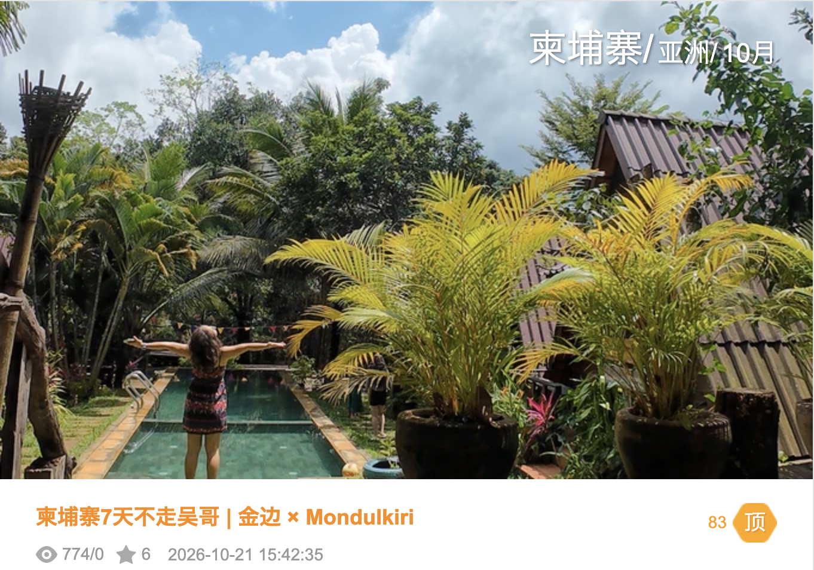

  十一年前，妈妈带着我和姥姥去暹粒看吴哥窟。十一年后，我们又一起去了柬埔寨。

  这次没有重游吴哥，而是选择了金边和东北部的 Mondulkiri。除了风景和行程，我也想记录两次旅行之间的变化，以及一家人仍然能够一起出发的快乐。

#### 更多旅行记录

- [**香港大屿山凤凰径第12段｜贝澳—梅窝｜三代同堂徒步记**](https://www.mafengwo.cn/i/24815164.html)
  约8.5公里的徒步路线，还有一次三代人一起露营的经历。

- **[新马泰10日游｜暴走、美食与奇遇记](https://www.mafengwo.cn/i/24801513.html)**

  高效串联新加坡、马来西亚、泰国三国核心体验，在紧凑行程中完成城市探索

- **[俄罗斯十日双城记 | 莫斯科&圣彼得堡文化探秘](https://www.mafengwo.cn/i/24374668.html)**

  疫情之后重新开启的家庭出境旅行，记录莫斯科与圣彼得堡的历史建筑、博物馆和旅途见闻。

- **[日本白马滑雪行 | 一周雪场独立规划与体验](https://www.mafengwo.cn/i/24644042.html)**

  第一次独自规划日本滑雪旅行，从铁路换乘到雪场体验。

- **[香港三天两夜 | 露营徒步与城市漫步一站式体验](https://www.mafengwo.cn/i/24514083.html)**

  设计并实践“自然+城市”复合行程，在有限时间内完成大屿山徒步、市区文化探访与露营体验。

- **[河南文化寻根 | 古都历史脉络与现代风貌探索](https://www.mafengwo.cn/i/24618237.html)**

  以“文化脉络”为主线串联郑州、开封、洛阳三地，一次文化与美食兼顾的旅行。

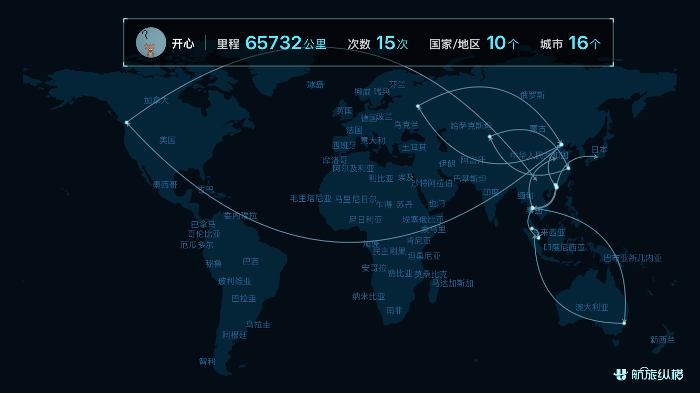

### 国际经历与综合视野

#### **澳大利亚查尔斯特大学循证医学联合研学**

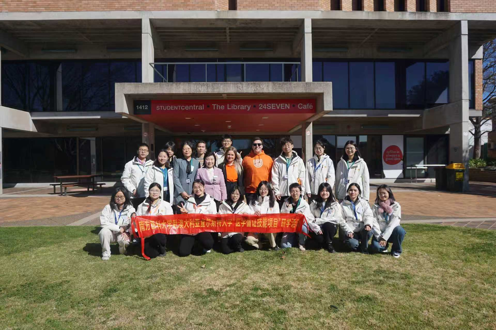
**项目时间**：2025年8月

**项目主题**：循证医学、系统评价与Meta分析、机器学习在医学中的应用

**合作院校**：澳大利亚查尔斯特大学（Charles Sturt University)

​	作为生物统计学专业本科生，入选南方医科大学与澳大利亚查尔斯特大学（CSU）合作的**国际循证医学培训项目**，赴澳进行为期10天的沉浸式科研学习。项目聚焦系统评价、Meta分析、机器学习、纳米医学等前沿方法在医学研究中的应用，由包括**孙静教授（生物统计学首席教授）** 在内的多名国际知名学者亲自授课。

#### 科研实践与产出

- **小组课题**：《Interventions for post-traumatic growth in breast cancer patients: a meta-analysis》

- **负责内容**：独立完成“Background & Objectives, Search Strategy, PICOS”部分的英文讲稿撰写与答辩汇报

- **科研注册**：参与完成PROSPERO系统评价方案

- **技能提升**：系统掌握EndNote文献管理、学术英语表达、跨文化团队协作能力

  **PROSPERO系统评价方案 ：** PROSPERO注册文件.pdf（材料可按需提供）

------

## 联系方式

- **邮箱**: [3227042017@i.smu.edu.cn](mailto:3227042017@i.smu.edu.cn)
- **作品集**: [GitHub Portfolio](https://github.com/Cathy-chenyx/chenyixin-portfolio-public)
