# Hi, I'm Yixin Chen 👋

[中文](README.md) | [English](README_EN.md) | [Download portfolio PDF (Chinese)](yixin-chen-portfolio.pdf)

I'm Yixin Chen, currently pursuing a master's degree in Applied Statistics at Southern Medical University, with an undergraduate background in Biostatistics.

Most of my work involves clinical research, statistical modeling, and data analysis. I also enjoy exploring projects that interest me, such as building a sample size calculator with R Shiny, working with real-world medical data, and studying applications of AI in statistical research. My internships at Parexel and Frost & Sullivan have given me different perspectives on medical research and industry practice.

A one- or two-page resume cannot hold all the work, the process behind each project, or the photos. I've collected them here, alongside my research and internships, articles, competitions, sports, and travel records.

**Biostatistics · Clinical Research · RWD/RWE · Data & AI**

## 📑 Contents

- [01 About Me](#01-about-me) — Education and academic background
- [02 Projects & Research](#02-projects--research) — Statistical tools, clinical research, and data analysis
- [03 Professional Experience](#03-professional-experience) — Parexel · Frost & Sullivan
- [04 Achievements & Credentials](#04-achievements--credentials) — Qualifications, academic competitions, and sports
- [05 Writing & Sharing](#05-writing--sharing) — Haisen's Candy Jar · My WeChat account and selected articles
- [06 Beyond Statistics](#06-beyond-statistics) — Travel, photography, and international study
- [Contact](#contact)

## 01 About Me

### Academic Record

**Official Transcript (2022–2025)**

- Overall GPA: 3.53/5.0

- Class rank: 12/39

- Strong results in core courses: Evidence-Based Medicine (97), Data Management (98), Survival Analysis (96.5), Clinical Trial Design (95.7), R Programming (95), and Statistical Modeling (94.9).

  View transcript: [Southern Medical University Transcript.pdf](evidence/academic/smu-undergraduate-transcript.pdf)

## 02 Projects & Research

### Clinical Trial Sample Size Calculator (SampleSize_R) – Undergraduate Thesis Project

**Description:** Independently developed an R Shiny sample size calculator as my undergraduate thesis project in Applied Statistics. It implements sample size methods for **32 common clinical research designs**, covering comparisons of means and proportions, equivalence testing, survival analysis, correlation, regression, and categorical data analysis. Features include filtering by three dimensions (data type, test type, and study design), dynamic parameter panels, dropout adjustment, and power curve visualization, supported by a detailed user manual and extension guide.

**Key technologies:** R Shiny, `PowerTOST`, `gsDesign`, `npsurvSS`, dynamic UI generation, statistical modeling, and parameter transformation.

**Outcomes:** Completed a professional sample size calculation tool with full functionality, documentation, and an extensible design. The thesis brought together the statistical principles behind clinical trial design and the full development process, from requirements and architecture to implementation. Modular functions, parameter templates, and examples make it easier for future researchers to add methods.

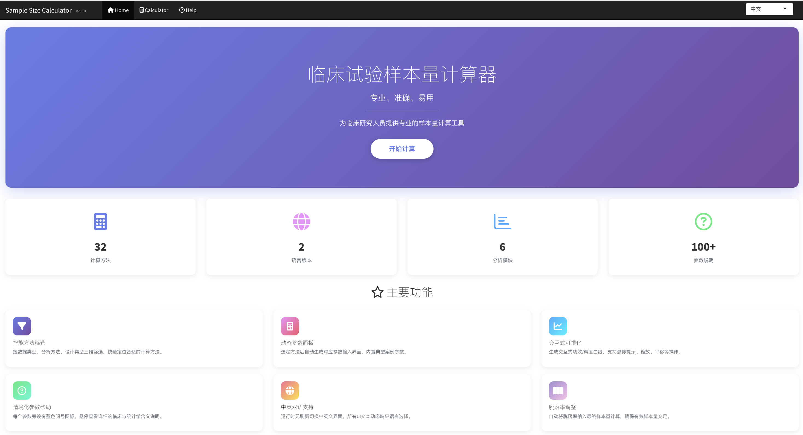

**Project links:** [Live demo](https://cathy-chenyx.shinyapps.io/SampleSize_R/) | GitHub repository (code is not public)

**Highlights:**

- **Broad methodological coverage:** Beyond basic statistical methods, the tool supports complex designs involving survival analysis (log-rank tests, restricted mean survival time [RMST], and milestone survival), correlation tests, partial F-tests in multiple linear regression, and proportional odds models for ordinal outcomes.
- **Rigorous and extensible:** Methods are managed through the `calculators_db.xlsx` registry. New methods can be added using a template without changing the core code.
- **Academic outputs:** The thesis documentation includes detailed statistical theory notes, a user manual, and a proposal, providing reference material for future research.

**Related outputs:** User manual (materials available on request) | Development notes (materials available on request)

------

### Sample Size Estimation Assistant (SSEA) – Contributing Developer

**Description:** Contributed as a student with a statistics background to SSEA, a clinical research calculation platform developed by a Zhujiang Hospital research group. My main responsibilities were parameter design and validation for statistical methods, along with parts of the user documentation. The platform covers randomized controlled trials (RCTs), observational studies, and diagnostic studies, aiming to make sample size calculation more accessible to clinical researchers.

**Contributions:**

- Helped validate the accuracy of sample size calculations (error rate < 0.1%).
- Contributed to the [SSEA tutorial article series](https://mp.weixin.qq.com/s/t2dFiUKlmI-tuyuoxMN4wA) to help users understand parameter settings.
- Provided statistical consultation to support appropriate method selection.

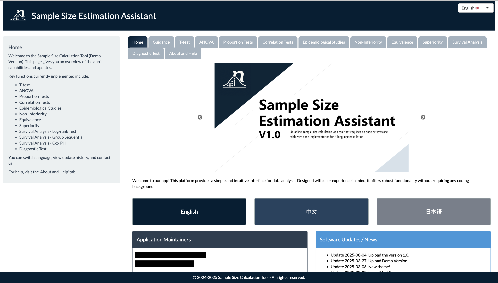

**Project link:** [SSEA online platform](https://smuonco.shinyapps.io/SSEA/)

**Tutorial article series:**

- [SSEA Guide I: Choosing a Study Setting and Configuring Parameters](https://mp.weixin.qq.com/s/t2dFiUKlmI-tuyuoxMN4wA)
- [SSEA Guide II: Sample Size Calculation for Diagnostic Studies](https://mp.weixin.qq.com/s/CwgVe3YOLTO4wzeEAUZWZA)
- [SSEA Guide III: Practical Sample Size Calculation for Observational Studies](https://mp.weixin.qq.com/s/DM30R7HMBcpnrCx6Ny1T8Q)
- [SSEA Guide IV: Sample Size Estimation for RCTs](https://mp.weixin.qq.com/s/xMvXZt7on93Tatr4KivF4A)

**Scan to try:**

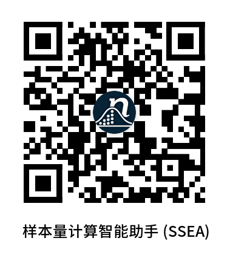

### Predicting In-hospital Gastrointestinal Bleeding in STEMI Patients – Statistical Modeling Competition Project

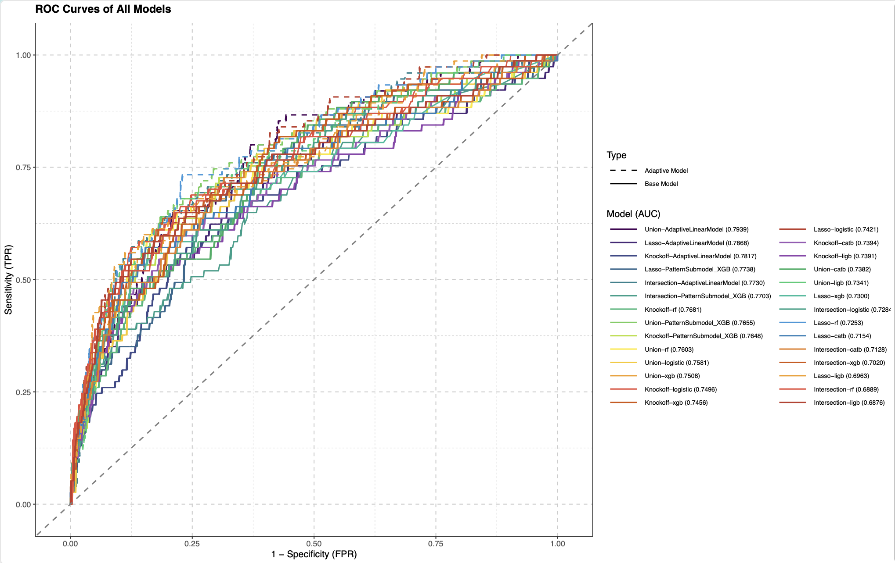

**Description:** Developed an interpretable gastrointestinal bleeding risk prediction model using real-world data from patients with ST-elevation myocardial infarction (STEMI) at Guangdong Provincial People's Hospital from 2010 to 2020. The model supports early identification of high-risk patients and optimization of antithrombotic and gastric mucosal protection strategies.

**Key technologies:** R, Python, multiple imputation (mice), combined Knockoff and Lasso variable selection with false discovery rate (FDR) control, adaptive linear regression, pattern submodels, ensemble learning (stacking/boosting), SHAP interpretation, and decision curve analysis (DCA).

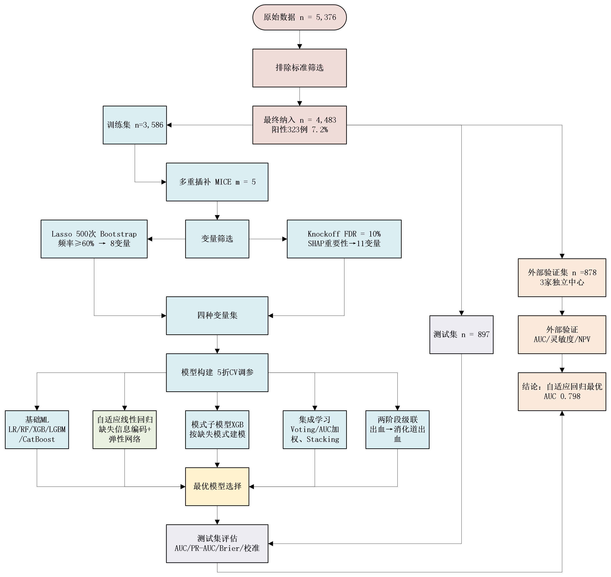

**Outcomes:**

- Built a complete analysis pipeline: data cleaning → removal of variables with more than 80% missingness → multiple imputation → variable selection → model training and validation.
- Systematically compared four variable sets (Knockoff/Lasso/Union/Intersection) and 12 models, including random forests, XGBoost, LightGBM, CatBoost, logistic regression, and adaptive linear regression.
- **The best model (Knockoff + adaptive linear regression) achieved a test-set area under the ROC curve (AUC) of 0.7977**, significantly outperforming traditional bleeding scores including CRUSADE (0.659), HAS-BLED (0.612), and HEMORRHAGES (0.688).
- Addressed missingness in real-world data through adaptive linear regression and pattern submodels, using missingness patterns for prediction without prior imputation and avoiding imputation error.
- Identified 11 clinically interpretable predictors, including proton pump inhibitor (PPI) use within 48 hours of admission, serum creatinine, hemoglobin, direct bilirubin, and uric acid. SHAP analysis and decision curves demonstrated positive net benefit across a broad range of thresholds.

**Related link:**

- [GitHub project repository](https://github.com/Cathy-chenyx/STEMI_Predictive_model)

### Trends in LLM Use in Scientific Peer Review and Model Validity

**Timeline:** June 2026–present | Collaborative research | Statistical modeling, model implementation, and validation analysis

**Description:** As large language models (LLMs) become part of academic writing, one question is whether the language distribution of scientific peer reviews changed before and after the release of ChatGPT.

Drawing on existing methods for estimating language mixtures at the population level, this study applies a maximum likelihood estimation (MLE) framework to public peer-review corpora. Reference distributions for human writing (H) and LLM-like language (Q) are used to estimate the language mixture parameter α across journals and time periods, followed by an examination of how the model responds to different forms of AI editing.

*The study is ongoing. Related findings and analysis materials have not yet been made public.*

### Prognostic Value of Stress Markers in ACS Patients – Multi-cohort Analysis and Risk Prediction

**Description:** Used real-world data from more than 4,000 patients hospitalized with acute coronary syndrome (ACS) at Guangdong Provincial People's Hospital from 2010 to 2015 to assess the independent predictive value of seven admission stress markers (HsCRP, BUN, cystatin C, NT-proBNP, uric acid, WBC, and lactate) for short- and long-term outcomes, including all-cause death and major adverse cardiovascular events (MACE), providing evidence for clinical risk stratification.

**Key technologies:** R, survival analysis (Kaplan–Meier [KM] and Cox regression), multivariable logistic regression, ROC analysis, three-level diabetes coding, and missingness pattern analysis.

**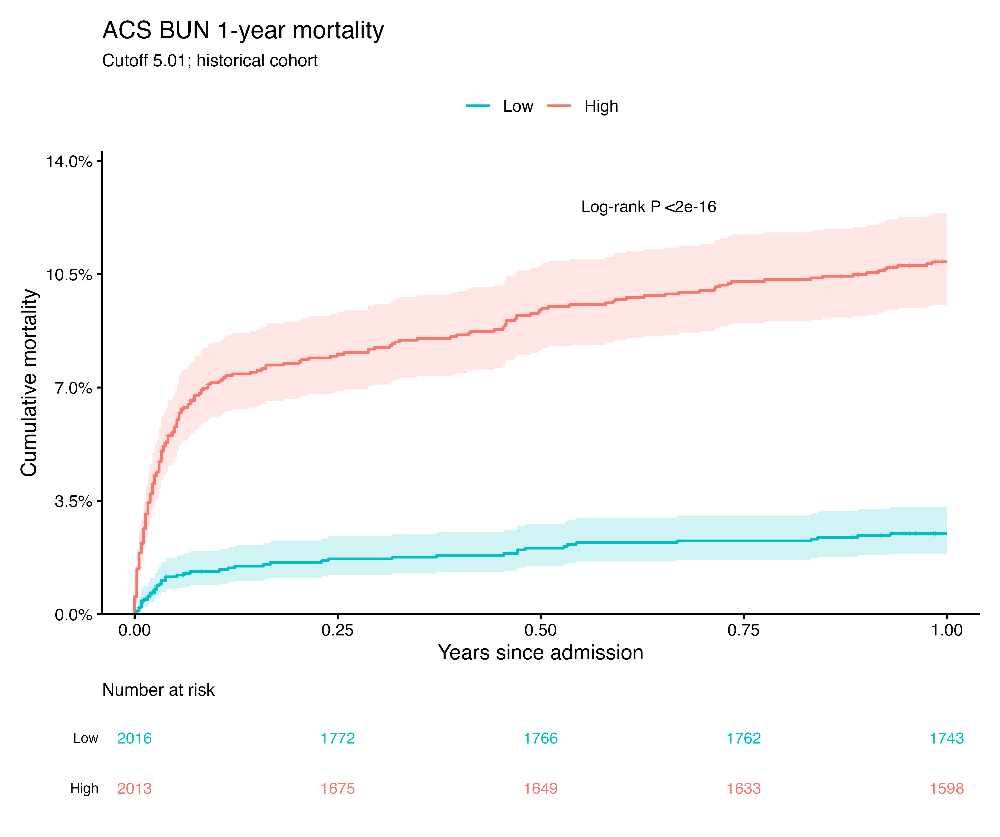**

**Outcomes:**

- Completed the full analysis workflow for three cohorts: all ACS patients, STEMI patients, and unstable angina plus non-STEMI (UA+NSTEMI) patients. Steps covered data cleaning, baseline comparisons, univariable and multivariable analyses, combined models, and ROC analysis.
- Lactate had a Cox regression hazard ratio (HR) of 1.21 (95% confidence interval [CI] 1.11–1.31) for long-term mortality in STEMI. KM curves in the high-lactate group were significantly higher than those in the low-lactate group at 30 days, 1 year, and 3 years.
- HsCRP, BUN, cystatin C, and NT-proBNP showed independent predictive value for death/MACE in multivariable models; several stress markers had AUC values above 0.6.
- Established a standardized R workflow and function library comprising 14 scripts to support reproducibility.

**Project link:** GitHub repository (code is not public)

### GBD Analysis of Gastrointestinal Cancer Burden in the Asia-Pacific Region

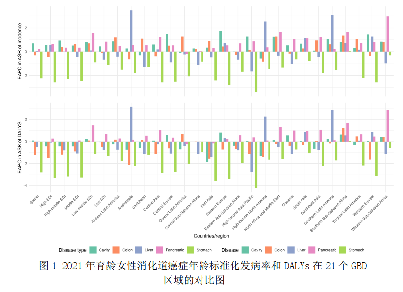

**Description:** Analyzed epidemiological trends and regional differences in gastrointestinal cancers in the Asia-Pacific region using Global Burden of Disease (GBD) data.

**Key technologies:** Joinpoint regression, APC analysis, ICD-10 code standardization, and data visualization.

**Outcomes:** Identified key trend change points (APC = −0.8%, p < 0.05) and created more than 15 visualizations to support decision-making.

**Related output:** [Statistical Modeling – GBD Disease Burden Analysis.pdf](reports/gbd-gastrointestinal-cancer-burden.pdf)

### Game User Retention Prediction – An XGBoost Machine Learning Application

**Description:** Built and deployed a user churn prediction system, addressing class imbalance and providing highly accurate real-time predictions.

**Key technologies:** XGBoost, SMOTE, SHAP interpretation, and R Shiny deployment.

**Outcomes:** Achieved 91.18% accuracy and won Second Prize nationally in the SAS China University Data Analysis Competition.

**Related output:** [Game User Retention Prediction Analysis.pdf](reports/game-user-retention-prediction.pdf)

**Project link:** https://gameretainpredictlab.shinyapps.io/smu-XGboost/

**Scan to try:**

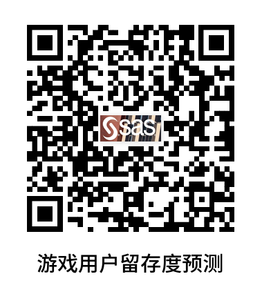

### Other Academic Outputs (Course Reports)

- [Survival Analysis – An Area-Based Hypothesis Testing Method for Left-Truncated Data](reports/left-truncated-survival-area-test.pdf)

- [Time Series Analysis – A Comparative Study of Recurrent Neural Network Models](reports/recurrent-neural-network-comparison.pdf)

- [Statistical Simulation – Comparing Proportion Tests in a Two-Stage Crossover Design](reports/two-stage-crossover-proportion-tests.pdf)

- [Genetic Statistics – Learning Causal Structures of Genetic Variation Using Bidirectional Mediated MR (BIMMER) and Causal Network Pruning Combining Graph Theory and MVMR (MRSL)](reports/genetic-causal-structure-learning.pdf)

  Nine academic documents in total; see the [Course and Project Reports](reports/).

## 03 Professional Experience

### Parexel International (Shanghai) Co., Ltd.

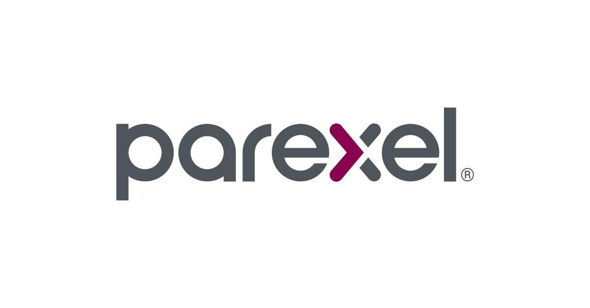

**RWD Strategy Intern**  | APAC RWD Strategy

Real-World Data Strategy Intern · *March 2026–September 2026 | Guangzhou*

Parexel is a leading global contract research organization (CRO), headquartered in the United States and operating worldwide. Its Asia-Pacific real-world data (RWD) strategy team supports pharmaceutical clients with data-based feasibility assessments, data source management, and real-world evidence (RWE) research across mainland China, Hong Kong, Taiwan, Japan, South Korea, Singapore, India, the Middle East, and other emerging markets.

During my six months as an intern with the Asia-Pacific RWD strategy team at this leading global CRO, I contributed to several projects involving healthcare data sources across the region. Through literature searches, database documentation, comparisons of data source feasibility, preparation of English research materials, and communication across teams, I gradually learned about the groundwork required before real-world studies can begin.

- [Parexel Internship Certificate.pdf](evidence/internships/parexel-internship-certificate.pdf)

### Frost & Sullivan

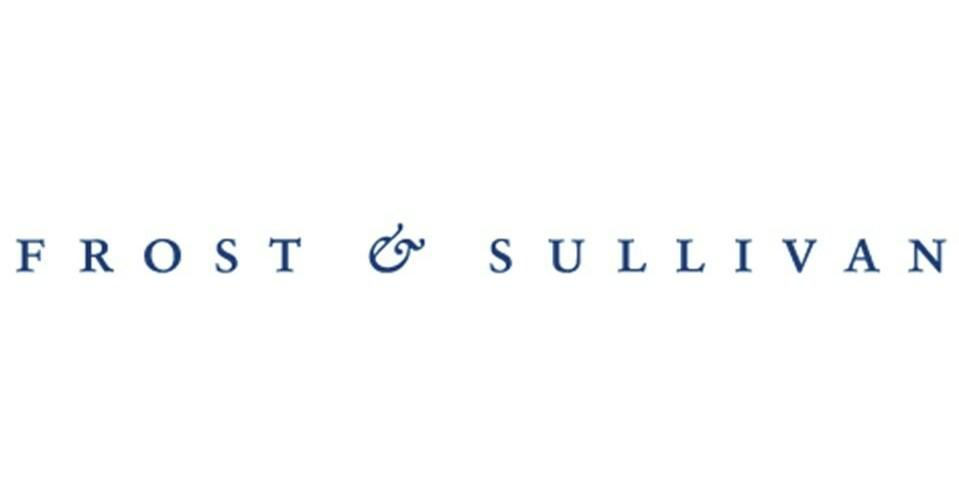

**Healthcare Consulting Intern** | Healthcare & Life Sciences

Healthcare Consulting Intern · *September 2026–present | Remote*

Frost & Sullivan is a global growth consulting firm founded in 1961 that entered the Chinese market in 1998. Its work spans industry research, strategy consulting, market analysis, valuation, and capital markets advisory. Its healthcare practice covers pharmaceuticals, biotechnology, medical devices, and healthcare services, providing industry research, market and competitive landscape analysis, and support for strategic decisions.

During my internship with the healthcare consulting team, I have contributed to oncology and autoimmune disease industry research, pharmaceutical industry blue books, and research deliverables. From breaking down research questions, searching the literature, and checking evidence across sources to drafting reports, presenting charts, and refining the work, I am learning to turn complex clinical, scientific, and industry information into clear, traceable research outputs.

* [Assessment Pass and Onboarding Correspondence](evidence/internships/frost-sullivan-assessment-feedback.pdf)

## 04 Achievements & Credentials

### Core Qualifications

| Certificate | Issuing organization | Date | Level / Result | Supporting evidence |
| :----------------------- | :----------------------------------------------------------- | :------- | :-------- | :----------------------------------------------------------- |
| Junior Data Analyst | Beijing Dongfang Aixue Information Technology Co., Ltd. | 2026.07 | Junior | [Junior Data Analyst Certificate.pdf](evidence/academic/junior-data-analyst-certificate.pdf) |
| Statistical Professional Qualification (Junior Level) | Ministry of Human Resources and Social Security; National Bureau of Statistics | 2025.10 | Passed | [Junior Statistician Certificate](evidence/academic/junior-statistician-certificate.pdf) |
| SAS Base Programmer Certification | SAS Institute | 2025.05 | Passed | [SAS Base Programmer Certification](evidence/academic/sas-base-programmer-certificate.pdf) |
| College English Test Band 6 (CET-6) | Ministry of Education | 2025.06 | 546 | [CET6 – 546.pdf](evidence/academic/cet6-score-546.pdf) |
| IELTS | British Council; IDP IELTS; Cambridge University Press & Assessment | 2025.02 | 6.0 | [IELTS.pdf](evidence/academic/ielts-score-report.pdf) |
| National Computer Rank Examination, Level 2 | Ministry of Education | 2023.03 | Passed | [Computer Level 2 Certificate.pdf](evidence/academic/computer-level-2-certificate.pdf) |

### Academic Competition Awards

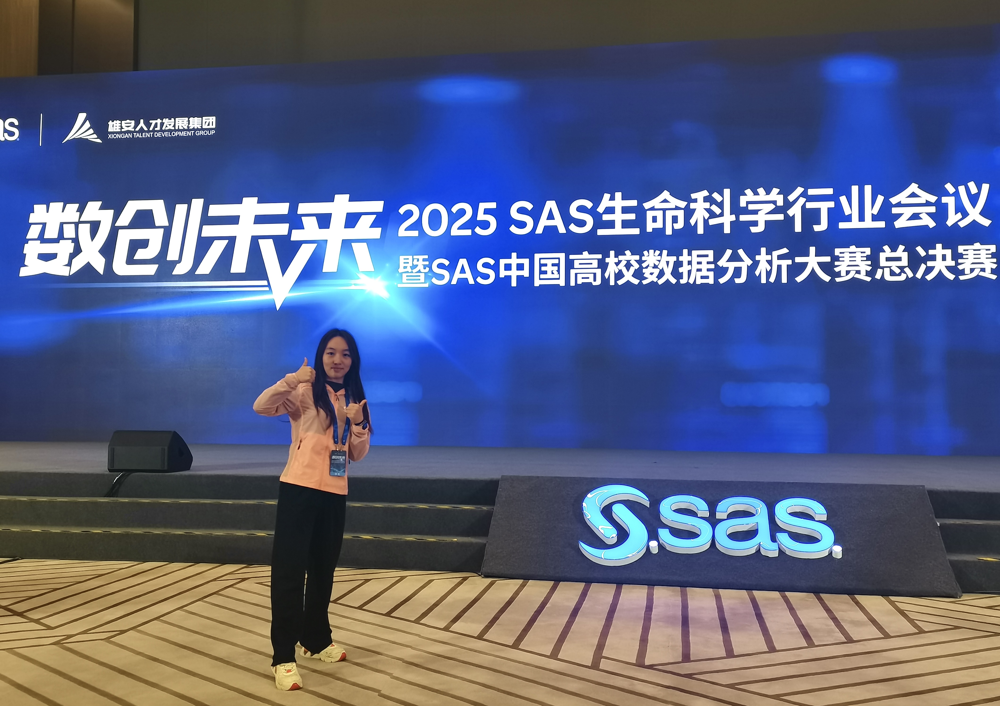

- 2024 SAS China University Data Analysis Competition – National Second Prize

  Supporting evidence: [SAS Competition Award Certificate.pdf](evidence/awards/sas-data-analysis-second-prize.pdf)
  [Official news](https://mp.weixin.qq.com/s/20FoBxp0UPmD3oKTmZS1yw)

- 2024 China Undergraduate Mathematical Contest in Modeling – Guangdong Third Prize

  Supporting evidence: [China Mathematical Modeling Competition Certificate.pdf](evidence/awards/cumcm-guangdong-third-prize.pdf)

- 2024 Mathematical Contest in Modeling (MCM) – Successful Participant Award

  Supporting evidence: [MCM Certificate.pdf](evidence/awards/mcm-successful-participant.pdf)

- 2025 National College Student Statistical Modeling Competition – Guangdong Third Prize

- Supporting evidence: [12th Statistical Modeling Competition Provincial Certificate.pdf](evidence/awards/statistical-modeling-provincial-third-prize.pdf)

### Career Skills and Broader Development

#### **3rd National College Student Career Planning Competition – University Special Prize (First Place) and Provincial Bronze Award** (November 2025)

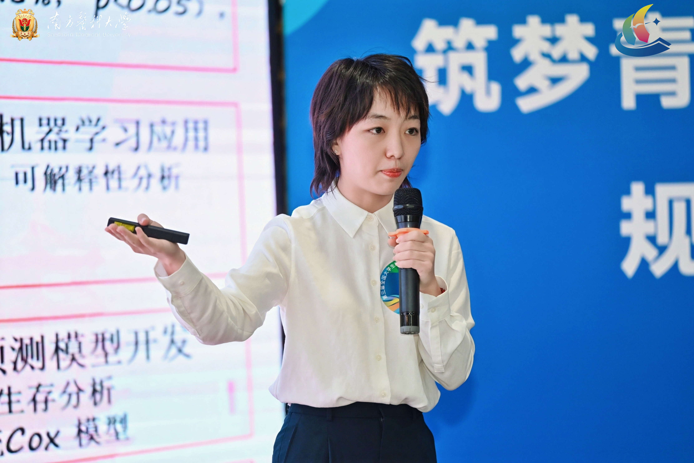

- Stood out among more than 2,000 university participants to win the highest award in the employment track.

[Career Planning Competition – Provincial Bronze Award Certificate](evidence/awards/career-planning-provincial-bronze.pdf)

> As the university selection round of a national career planning competition, the event aims to strengthen students' employability. In the final, a **themed presentation** and **comprehensive interview** demonstrated how my skills align with industry roles, alongside a clear career path and practical job-seeking abilities. The judging panel included university career planning experts and HR leaders from established companies, lending weight to the award.
>
> **Official news:** [More Than 2,000 Participants Compete in the Career Planning Competition](https://news.smu.edu.cn/info/1014/125316.htm)

#### **3rd Public Health Leadership Competition | Team Second Prize** (October 2026)

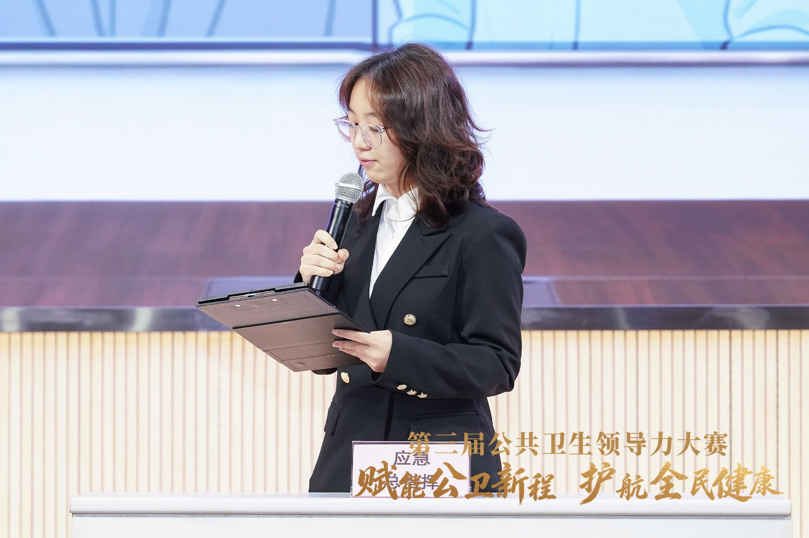

In October 2026, I represented Southern Medical University at the 3rd Public Health Leadership Competition, exchanging ideas with public health students from universities across Guangdong, Hong Kong, and Macao. Our team won **Second Prize**.

The competition included public health knowledge quizzes, case presentations, and simulated decision-making for public health emergencies, assessing professional knowledge, emergency analysis, and teamwork.

I mainly contributed to **big data and AI-based prevention and control planning, along with technical support**, helping design approaches that connect public health needs with data analysis and AI.

Official news: [Empowering Public Health and Protecting Health for All – Finals of the 3rd Public Health Leadership Competition](https://mp.weixin.qq.com/s/jAoXCa3XLTYxmzM88B6Mtw)

### University Honors

- **University First-Class Scholarship** (2023–2024)

- **University Third-Class Scholarship** (2024–2025)

- **Outstanding Student** (2023–2024, 2024–2025)

- **School of Public Health “Top Ten Stars” – Sports Star** (2025)
  - Awarded to student representatives with outstanding athletic achievements, sportsmanship, and team leadership.
  **Official news:** [Meet the School of Public Health's 15th “Top Ten Stars,” 2025](https://news.smu.edu.cn/info/1014/127546.htm)
  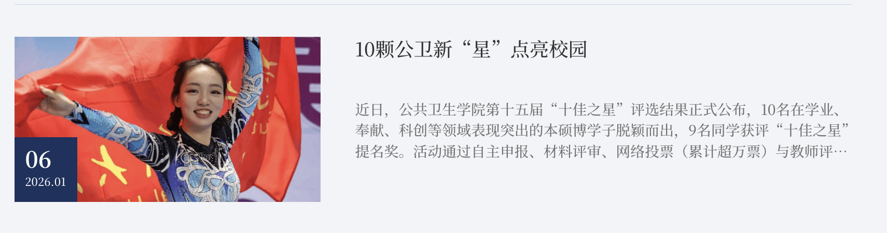

  **Supporting evidence:** [University Honors.pdf](evidence/awards/university-honors.pdf)

### Athletic Achievements

I have received **one national silver medal**, **one national bronze medal**, **one provincial gold medal**, and **two provincial silver medals**, with six major awards at provincial level or above in total.

As a core team member, I achieved leading placements in **trios, mixed pairs, and groups of five** at the **China University Aerobic Gymnastics Championships** and **Guangdong University Aerobic Gymnastics Championships**, demonstrating close teamwork.

Official news 🔗

- [Five Gold, Two Silver, One Bronze, and Three Consecutive Years at the Top of the Team Standings: SMU at the Provincial Championships](https://www.smu.edu.cn/info/1139/35559.htm)
- [SMU Aerobic Gymnastics Team Wins Four Bronze Medals at the China University Championships](https://www.smu.edu.cn/info/1139/60389.htm)
- [SMU Aerobic Gymnastics Team Wins Two Silver Medals at the Provincial University Games](https://news.smu.edu.cn/info/1014/115606.htm)

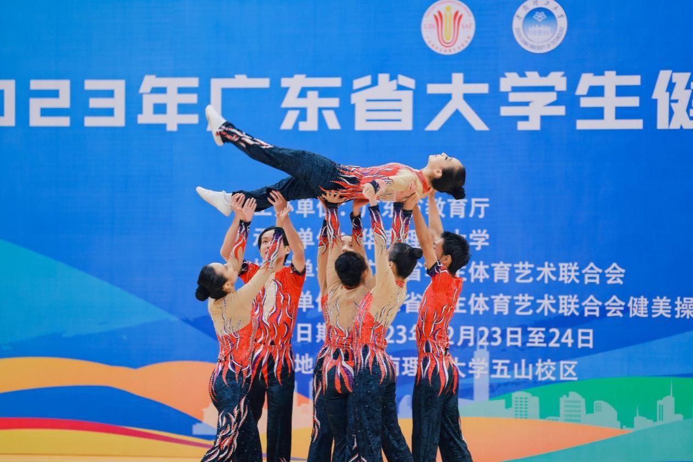

* **China University Aerobic Gymnastics Championships – National Runner-up** (2023)

> **Supporting evidence:** [National Runner-up Certificate.pdf](evidence/awards/national-aerobics-runner-up-2023.pdf)

- **Guangdong University Aerobic Gymnastics Championships – First in Overall Team Standings and Freehand Routine Champion** (2024 & 2023)

> As a key team member, I helped lead the team to the **highest team honor** at the provincial championships over two years and won a **provincial championship** in an event in which I played a leading role, demonstrating sustained performance and leadership.
>
> **Supporting evidence:** [Freehand Routine Champion.pdf](evidence/awards/guangdong-aerobics-freehand-champion-2023.pdf) [Overall Team Standings.pdf](evidence/awards/guangdong-aerobics-team-first-2024.pdf)

- **China University Aerobic Gymnastics Championships – Aerobic Step Third Place** (2024)

 > Won another national medal in a different event at the same leading competition, demonstrating technical versatility and consistent performance.
 >
 > **Supporting evidence:** [Aerobic Step Third Place.pdf](evidence/awards/national-aerobics-step-third-18th.pdf)

- **Top-four Finishes in Multiple National and Provincial Team Events** (trios, mixed pairs, and groups of five)

 > As a core member, I achieved top-four national and provincial placements in several events requiring close coordination, reflecting teamwork and mutual trust.
 >
 > **Supporting evidence:** [2023 Provincial Trios – Fourth Place.pdf](evidence/awards/guangdong-aerobics-trios-fourth-2023.pdf)
 > [2024 National Group of Five – Fourth Place.pdf](evidence/awards/national-aerobics-group-five-fourth-18th.pdf)
 > [2024 National Mixed Pairs – Fourth Place.pdf](evidence/awards/national-aerobics-mixed-pairs-fourth-18th.pdf)
 > [2024 Provincial Aerobic Step – Fifth Place.pdf](evidence/awards/guangdong-aerobics-step-fifth-2024.pdf)
 > [Guangdong University Games Trios – Fourth Place.pdf](evidence/awards/guangdong-university-games-trios-fourth-12th.pdf)

### Other Campus Activities and Awards

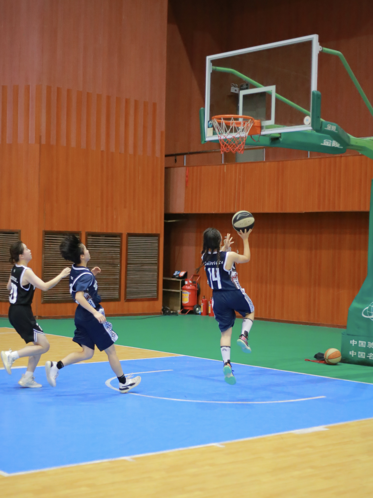

- Southern Medical University Grand Slam Basketball Tournament – Champion (2024)

- Southern Medical University Fengxiang Cup Basketball Tournament – Runner-up (2023)

- Southern Medical University Fengxiang Cup Table Tennis Tournament – Fourth Place (2023)

- Southern Medical University Sports Meet, Long Jump – Fifth Place (2023)

- Southern Medical University Rope Skipping Competition – Fifth Place (2024)

**Supporting evidence: see the [Supplementary Materials folder](evidence/supplementary/).**

## 05 Writing & Sharing

WeChat account, professional articles, academic conferences, and study notes

### Haisen's Candy Jar (嗨森的糖罐子) | My WeChat Account

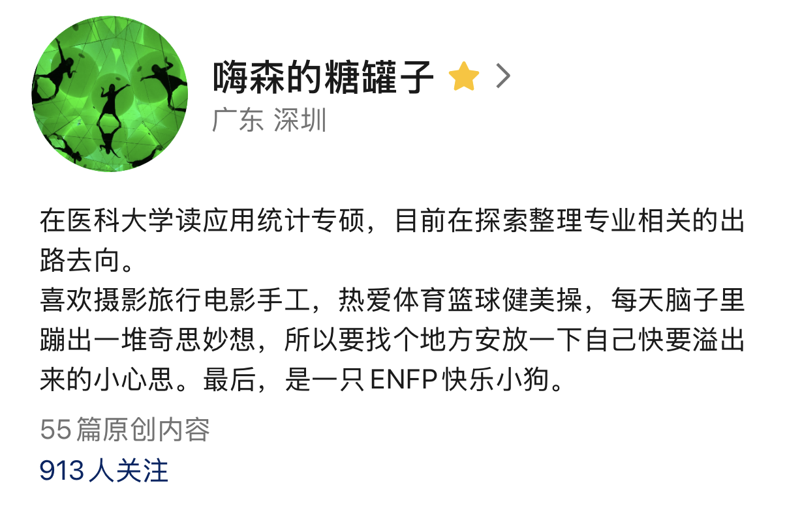

Since my undergraduate years, I've enjoyed writing about what I learn, the projects I work on, and interesting things in everyday life. Over time, this became my WeChat public account, “Haisen's Candy Jar” (嗨森的糖罐子).

I started with course notes, postgraduate entrance exam experiences, and study resources. My topics gradually expanded to biostatistics, real-world research, the MIMIC database, academic conferences, travel, film reviews, and personal essays.

#### 📊 Account Overview

**Content Creation**

- **Content creation:** Running since December 2023, with **50+ content publications** covering professional knowledge, study experiences, practical tutorials, and personal essays.
- **Follower growth:** Passed 500 followers on August 23, 2026. By late November 2026, the total was approaching 900, with growth over the preceding three months.
- **Reach:** Reached milestones of 1,000 cumulative shares and 500 saves; a representative professional article received more than 5,000 views.
- **Reader interaction:** Received more than 100 reader comments, maintaining conversations and updating content in response to practical questions.
- **Content operations:** Independently handle topic selection, research, writing, cover design, layout, and publishing, using views, shares, saves, and reader feedback to guide future topics.

**Selected Results**

- Professional writing | Sharing discoveries from academic conferences
  [2026 Biostatistics Conference | What Can Health Insurance Data Tell Us About Real-World Research?](https://mp.weixin.qq.com/s/J8dgx15jJm-n9E8T1muj4A)
  **5,718 views** and 174 saves. Drawing on Professor Fang Jiqian's invited lecture, the article explores the potential and limitations of health insurance data in real-world research, alongside my own conference experiences.

  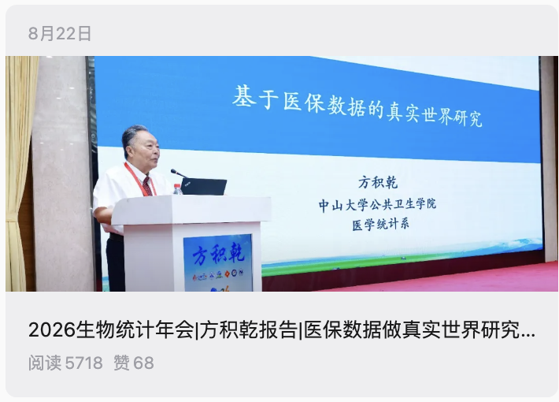

- Study experiences | An imperfect year preparing for the postgraduate entrance exam
  [2026 Applied Statistics Entrance Exam | My Year of Preparation](https://mp.weixin.qq.com/s/9lZ0wqs8x-s5WFzpiLd-tg)
  **5,508 views**, and republished by “Public Health × Career” (公卫X生涯).

  This is not a conventional high-score success story. I wrote about the frustration of struggling with mathematics, seeking help from senior students, and my approaches to English and subject-specific revision.

  I wanted both to keep a record for myself and to help students preparing for the exam avoid some of the difficulties I encountered.

  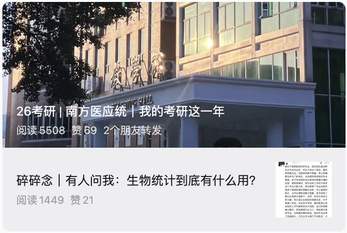

* **Practical tutorials | Solving everyday problems for fellow students**

[From i.smu to smu.edu | Applying for an SMU Graduate Email Account and Setting Up Outlook](https://mp.weixin.qq.com/s/-1Cq8WnWDBZcddgREAeRHw)

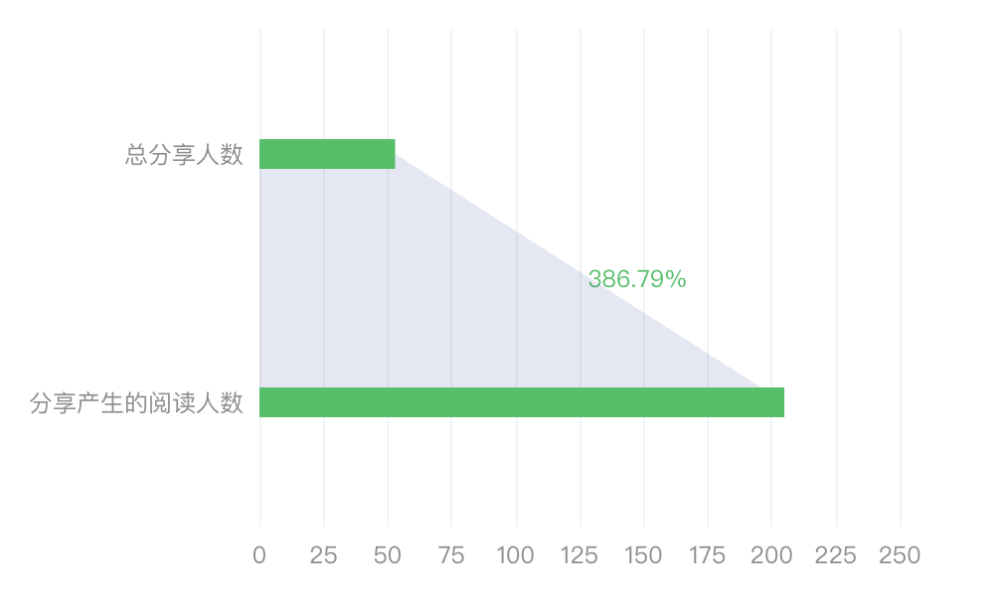

**3,388 views**, with **353 shares, 49 likes, 30 “Wow” reactions, and 22 comments**.

Based on my experience applying for and configuring a graduate email account, I put together a tutorial that others could follow. It showed me that solving one specific problem can sometimes help people more than a long article.

#### ✍️ Selected Original Articles

**Career & Personal Stories**

- [I Didn't Have Everything Figured Out Before Starting | From Entrance Exams and Job Hunting to an Unexpected RWD Internship](https://mp.weixin.qq.com/s/AgghBncOssy6EyHbzN6aZQ)
  Career choices, job hunting, and an unexpected internship opportunity.

**Biostatistics & Learning**

- [Thoughts on Biostatistics | What Is Our Major Really About?](https://mp.weixin.qq.com/s/pMTSRRFz8OGGw_DR4yJofQ)
  What I study in biostatistics and what the field involves.
- [Thoughts on the Statistical Professional Qualification Exam | Worth Taking or Better Avoided?](https://mp.weixin.qq.com/s/GGdP_tu5MNSAHMM2aHMhLQ)
  My preparation experience and personal reflections on the qualification exam.

**Life & Stories**

- [Before Sunrise | Some People Stay With You After Just One Meeting](https://mp.weixin.qq.com/s/tN1r07jMXsnW2ksW_P9trg)
  An essay about film, encounters, and memory.

## 06 Beyond Statistics

### Travel & Photography

Beyond statistics, I also love traveling, taking photos, and writing travel journals.

Before a trip, I usually spend time researching transport, planning routes, and finding places I'd like to visit. Once I'm on the road, there are always people and experiences I couldn't have planned for. Often, those surprises become the most memorable parts.

I like turning my photos, itineraries, and experiences into travel journals, both as a record for myself and as a reference for others planning to visit the same places.

**Travel profile:** [Mafengwo | Travel Journals](https://www.mafengwo.cn/u/58350948/note.html)

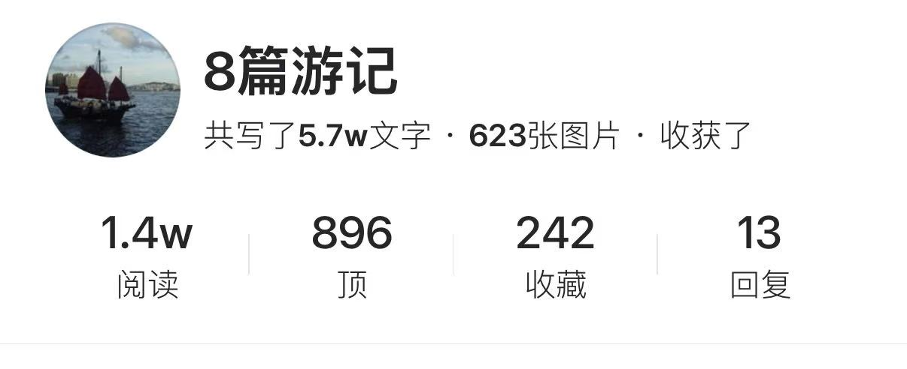

#### Featured Travel Journals

* [A Hainan Road Trip | Mountains, Coastlines, and Everyday Life Around the Island](https://www.mafengwo.cn/i/24805402.html)
  *January 2026 · Hainan*

  

**Platform recognition:** ⭐ **Mafengwo “Star Travel Journal”**

**Highlights:** Independently planned and completed a six-day, 600+ km road trip around Hainan. Coordinated car rental, accommodation, local experiences, and a variety of meals across coastal resorts, rainforest visits, historic towns, and local markets.

Over six days, I recorded the food, coastlines, cities, and small surprises along the way. I turned them into a journal with routes, accommodation, food recommendations, and plenty of original photos, which received Mafengwo's official Star Travel Journal recognition.

* [**Seven Days in Cambodia Beyond Angkor | Phnom Penh × Mondulkiri**](https://www.mafengwo.cn/i/24934223.html)
  *October 2026 · Cambodia*

  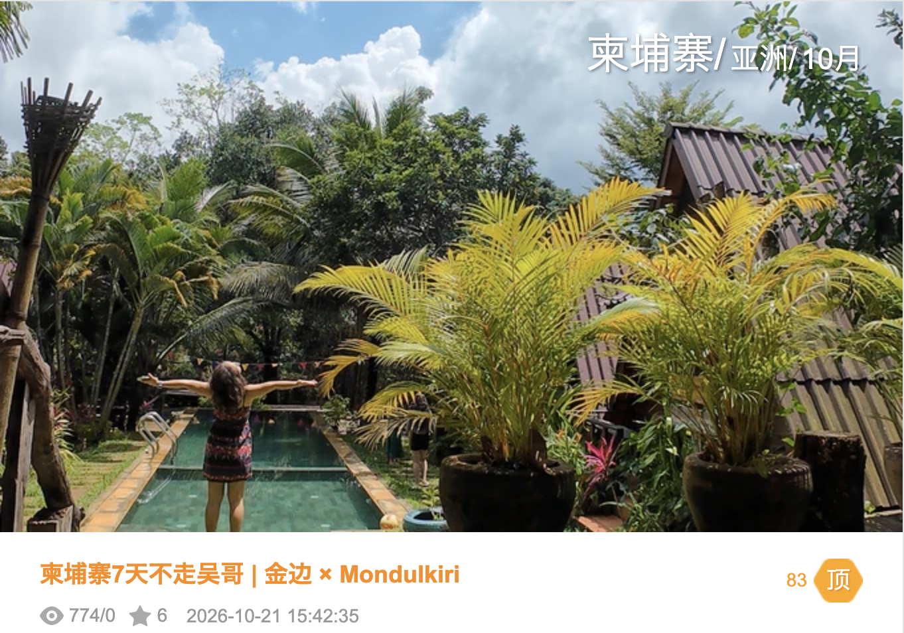

  Eleven years ago, my mother took my grandmother and me to Siem Reap to visit Angkor Wat. Eleven years later, the three of us traveled to Cambodia again.

  This time, we chose Phnom Penh and northeastern Mondulkiri instead of revisiting Angkor. Beyond the scenery and itinerary, I wanted to record what had changed between the two trips, and the joy of still being able to travel together as a family.

#### More Travel Records

- [**Lantau Trail Section 12, Hong Kong | Pui O to Mui Wo | A Three-Generation Family Hike**](https://www.mafengwo.cn/i/24815164.html)
  An approximately 8.5 km hike, together with a camping trip spanning three generations.

- **[Ten Days in Singapore, Malaysia, and Thailand | Walking, Food, and Unexpected Encounters](https://www.mafengwo.cn/i/24801513.html)**

  Connected key experiences across Singapore, Malaysia, and Thailand, exploring three countries on a compact itinerary.

- **[Ten Days in Two Russian Cities | Culture in Moscow and St. Petersburg](https://www.mafengwo.cn/i/24374668.html)**

  A family trip abroad after the pandemic, recording historic architecture, museums, and experiences in Moscow and St. Petersburg.

- **[A Week Skiing in Hakuba, Japan | Independent Planning and Experience](https://www.mafengwo.cn/i/24644042.html)**

  My first independently planned ski trip to Japan, from train transfers to time on the slopes.

- **[Three Days and Two Nights in Hong Kong | Camping, Hiking, and City Walks](https://www.mafengwo.cn/i/24514083.html)**

  Planned and completed an itinerary combining nature and city life, fitting Lantau hiking, urban cultural visits, and camping into a short trip.

- **[Tracing Culture in Henan | Ancient Capitals and Modern Life](https://www.mafengwo.cn/i/24618237.html)**

  A journey through Zhengzhou, Kaifeng, and Luoyang, following cultural connections while enjoying local food.

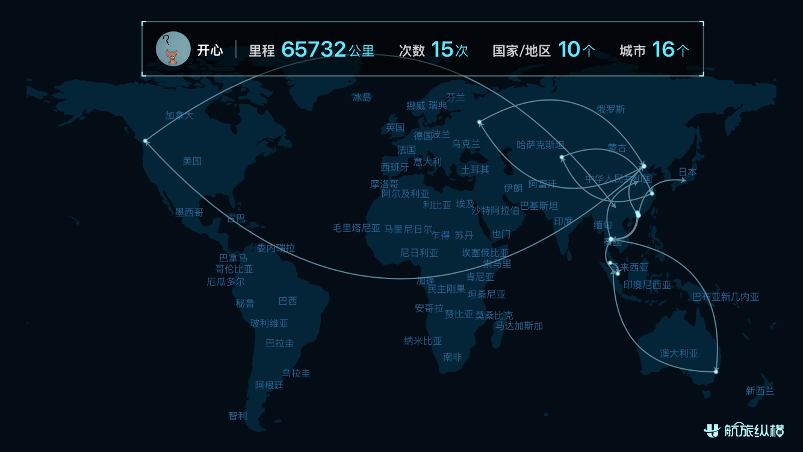

### International Experience and Broader Perspectives

#### **Evidence-Based Medicine Study Program at Charles Sturt University, Australia**

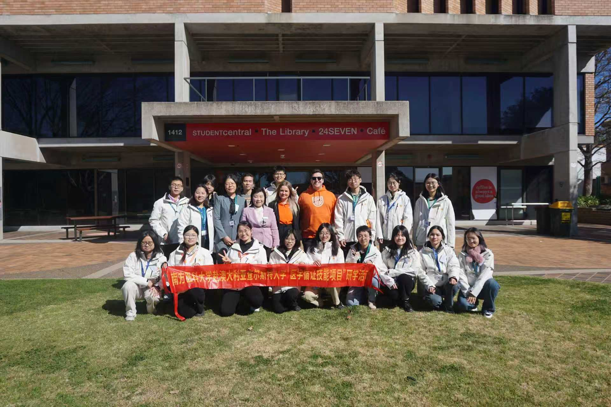
**Date:** August 2025

**Topics:** Evidence-based medicine, systematic reviews and meta-analysis, and applications of machine learning in medicine.

**Partner institution:** Charles Sturt University (CSU), Australia

As a Biostatistics undergraduate, I was selected for the **international evidence-based medicine training program** jointly organized by Southern Medical University and Charles Sturt University (CSU), traveling to Australia for 10 days of immersive research study. The program focused on applications of systematic reviews, meta-analysis, machine learning, and nanomedicine in medical research, with teaching by internationally recognized academics including **Professor Jing Sun (Chief Professor of Biostatistics)**.

#### Research Practice and Outputs

- **Group project:** Interventions for post-traumatic growth in breast cancer patients: a meta-analysis

- **Responsibilities:** Independently wrote and presented the English sections covering “Background & Objectives, Search Strategy, PICOS.”

- **Research registration:** Contributed to the PROSPERO systematic review protocol.

- **Skills developed:** EndNote reference management, academic English communication, and cross-cultural teamwork.

  **PROSPERO systematic review protocol:** PROSPERO Registration.pdf (available on request)

------

## Contact

- **Email:** [3227042017@i.smu.edu.cn](mailto:3227042017@i.smu.edu.cn)
- **Portfolio:** [GitHub Portfolio](https://github.com/Cathy-chenyx/chenyixin-portfolio-public)
